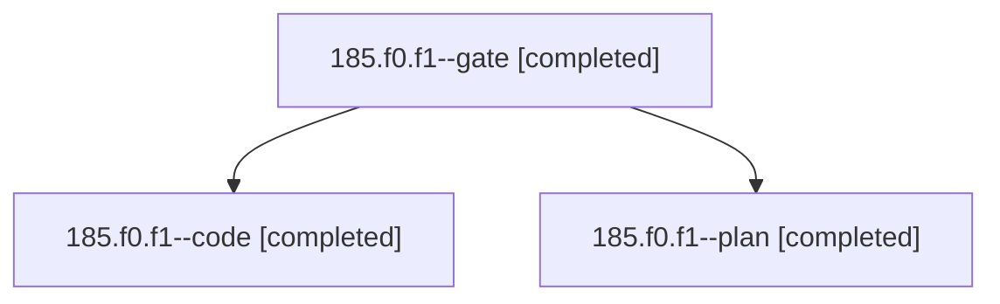

# Session: 185.f0.f1

[Agent Hoods](../README.md) / [bbugyi200](../users/bbugyi200/README.md) / [athena](../users/bbugyi200/machines/athena/README.md) / [185](../users/bbugyi200/machines/athena/hoods/185/README.md) / 185.f0.f1

Owner: `bbugyi200.athena` · Hood: `185` · Members: 3

## Lineage

The diagram is an optional enhancement; the ordered table below contains the same lineage in accessible text.

| Role | Agent | State | Model / provider | Timing | Commits | Prompt | Chat |
|---|---|---|---|---|---:|---|---|
| gate | 185.f0.f1--gate | completed | opus / claude | 2026-11-04T22:39:49.377158+00:00 → 2026-11-04T22:40:36.469121+00:00 | 0 | — | [Chat](../agents/bbugyi200.athena.185.f0.f1--gate/chat.md) |
| code | 185.f0.f1--code | completed | gpt-6-luna / codex | 2026-11-04T23:39:14.587473+00:00 → 2026-11-05T01:21:50.565200+00:00 | [1](../agents/bbugyi200.athena.185.f0.f1--code/README.md#commits) | [Prompt](../agents/bbugyi200.athena.185.f0.f1--code/prompt.md) | [Chat](../agents/bbugyi200.athena.185.f0.f1--code/chat.md) |
| plan | 185.f0.f1--plan | completed | opus / claude | 2026-11-04T22:17:42.810613+00:00 → 2026-11-04T22:36:51.870595+00:00 | 0 | [Prompt](../agents/bbugyi200.athena.185.f0.f1--plan/prompt.md) | [Chat](../agents/bbugyi200.athena.185.f0.f1--plan/chat.md) |

## Commits

| Role | Repo | Commit | Subject | Committed |
|---|---|---|---|---|
| code | bob-cli | [`1dc7c37`](https://github.com/bobs-org/bob-cli/commit/1dc7c37be38d2f7300dabfa9ecaa722ad3e5299a) | feat(capture): alias comma to parent task picker | 2026-11-04 20:03:25 EST |

## Neighbors

| Agent | Relation | State |
|---|---|---|
| [185.f0](bbugyi200.athena.185.f0.md) (session · 3) | ancestor | completed 3 |
| [185](bbugyi200.athena.185.md) (session · 9) | ancestor | completed 6, failed 3 |
| [185.f0.f0](../agents/bbugyi200.athena.185.f0.f0/README.md) | 185.f0 hood | active |
| [185.f0.f2](bbugyi200.athena.185.f0.f2.md) (session · 3) | 185.f0 hood | completed 3 |
| [185.f0.f2.f0](bbugyi200.athena.185.f0.f2.f0.md) (session · 2) | 185.f0 hood | active 1, completed 1 |
