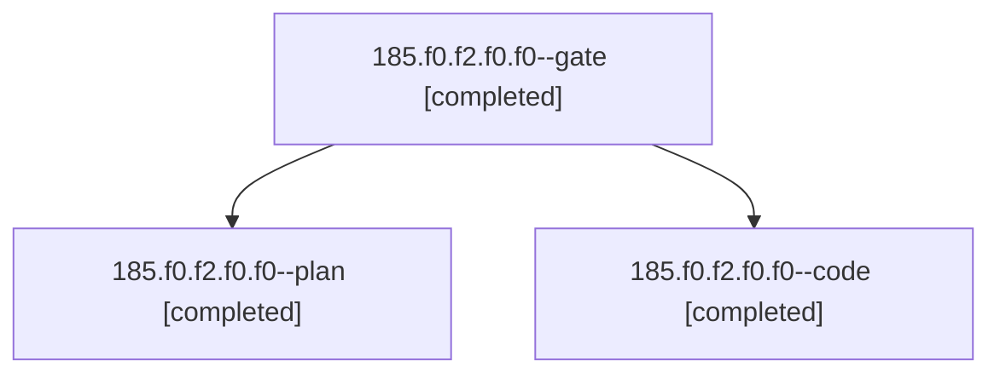

# Session: 185.f0.f2.f0.f0

[Agent Hoods](../README.md) / [bbugyi200](../users/bbugyi200/README.md) / [athena](../users/bbugyi200/machines/athena/README.md) / [185](../users/bbugyi200/machines/athena/hoods/185/README.md) / 185.f0.f2.f0.f0

Owner: `bbugyi200.athena` · Hood: `185` · Members: 3

## Lineage

The diagram is an optional enhancement; the ordered table below contains the same lineage in accessible text.

| Role | Agent | State | Model / provider | Timing | Commits | Prompt | Chat |
|---|---|---|---|---|---:|---|---|
| gate | 185.f0.f2.f0.f0--gate | completed | opus / claude | 2026-11-05T13:10:09.978852+00:00 → 2026-11-05T13:10:46.831819+00:00 | 0 | — | [Chat](../agents/bbugyi200.athena.185.f0.f2.f0.f0--gate/chat.md) |
| plan | 185.f0.f2.f0.f0--plan | completed | opus / claude | 2026-11-05T12:41:50.799216+00:00 → 2026-11-05T12:56:15.653291+00:00 | 0 | [Prompt](../agents/bbugyi200.athena.185.f0.f2.f0.f0--plan/prompt.md) | [Chat](../agents/bbugyi200.athena.185.f0.f2.f0.f0--plan/chat.md) |
| code | 185.f0.f2.f0.f0--code | completed | muse-spark-1.3-contributor / muse | 2026-11-05T13:11:39.093124+00:00 → 2026-11-05T14:01:29.864645+00:00 | [1](../agents/bbugyi200.athena.185.f0.f2.f0.f0--code/README.md#commits) | [Prompt](../agents/bbugyi200.athena.185.f0.f2.f0.f0--code/prompt.md) | [Chat](../agents/bbugyi200.athena.185.f0.f2.f0.f0--code/chat.md) |

## Commits

| Role | Repo | Commit | Subject | Committed |
|---|---|---|---|---|
| code | bob-cli | [`7e43741`](https://github.com/bobs-org/bob-cli/commit/7e437418e958a12ed999053c425003eb9831eb52) | feat(capture): alias / to # where a completion menu opens | 2026-11-05 09:01:02 EST |

## Neighbors

| Agent | Relation | State |
|---|---|---|
| [185.f0.f2.f0](bbugyi200.athena.185.f0.f2.f0.md) (session · 5) | ancestor | completed 4, failed 1 |
| [185.f0.f2](bbugyi200.athena.185.f0.f2.md) (session · 3) | ancestor | completed 3 |
| [185.f0](bbugyi200.athena.185.f0.md) (session · 3) | ancestor | completed 3 |
| [185](bbugyi200.athena.185.md) (session · 9) | ancestor | completed 6, failed 3 |
| [185.f0.f0](../agents/bbugyi200.athena.185.f0.f0/README.md) | 185.f0 hood | active |
| [185.f0.f1](bbugyi200.athena.185.f0.f1.md) (session · 3) | 185.f0 hood | completed 3 |
