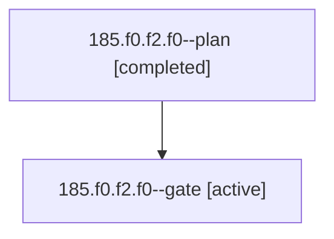

# Session: 185.f0.f2.f0

[Agent Hoods](../README.md) / [bbugyi200](../users/bbugyi200/README.md) / [athena](../users/bbugyi200/machines/athena/README.md) / [185](../users/bbugyi200/machines/athena/hoods/185/README.md) / 185.f0.f2.f0

Owner: `bbugyi200.athena` · Hood: `185` · Members: 2

## Lineage

The diagram is an optional enhancement; the ordered table below contains the same lineage in accessible text.

| Role | Agent | State | Model / provider | Timing | Commits | Prompt | Chat |
|---|---|---|---|---|---:|---|---|
| plan | 185.f0.f2.f0--plan | completed | opus / claude | 2026-11-04T23:48:31.146023+00:00 → 2026-11-05T00:02:37.065920+00:00 | 0 | [Prompt](../agents/bbugyi200.athena.185.f0.f2.f0--plan/prompt.md) | [Chat](../agents/bbugyi200.athena.185.f0.f2.f0--plan/chat.md) |
| gate | 185.f0.f2.f0--gate | active | opus / claude | 2026-11-05T00:02:33.347218+00:00 | 0 | — | — |

## Neighbors

| Agent | Relation | State |
|---|---|---|
| [185.f0.f2](bbugyi200.athena.185.f0.f2.md) (session · 3) | ancestor | completed 3 |
| [185.f0](bbugyi200.athena.185.f0.md) (session · 3) | ancestor | completed 3 |
| [185](bbugyi200.athena.185.md) (session · 9) | ancestor | completed 6, failed 3 |
| [185.f0.f0](../agents/bbugyi200.athena.185.f0.f0/README.md) | 185.f0 hood | active |
| [185.f0.f1](bbugyi200.athena.185.f0.f1.md) (session · 3) | 185.f0 hood | completed 3 |
