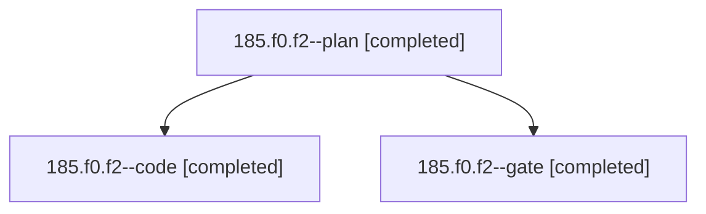

# Session: 185.f0.f2

[Agent Hoods](../README.md) / [bbugyi200](../users/bbugyi200/README.md) / [athena](../users/bbugyi200/machines/athena/README.md) / [185](../users/bbugyi200/machines/athena/hoods/185/README.md) / 185.f0.f2

Owner: `bbugyi200.athena` · Hood: `185` · Members: 3

## Lineage

The diagram is an optional enhancement; the ordered table below contains the same lineage in accessible text.

| Role | Agent | State | Model / provider | Timing | Commits | Prompt | Chat |
|---|---|---|---|---|---:|---|---|
| plan | 185.f0.f2--plan | completed | opus / claude | 2026-11-04T22:16:29.553441+00:00 → 2026-11-04T22:35:08.479257+00:00 | 0 | [Prompt](../agents/bbugyi200.athena.185.f0.f2--plan/prompt.md) | [Chat](../agents/bbugyi200.athena.185.f0.f2--plan/chat.md) |
| code | 185.f0.f2--code | completed | muse-spark-1.3-contributor / muse | 2026-11-04T22:37:47.132902+00:00 → 2026-11-04T23:24:37.196255+00:00 | [1](../agents/bbugyi200.athena.185.f0.f2--code/README.md#commits) | [Prompt](../agents/bbugyi200.athena.185.f0.f2--code/prompt.md) | [Chat](../agents/bbugyi200.athena.185.f0.f2--code/chat.md) |
| gate | 185.f0.f2--gate | completed | opus / claude | 2026-11-04T22:35:34.587826+00:00 → 2026-11-04T22:37:08.383187+00:00 | 0 | — | [Chat](../agents/bbugyi200.athena.185.f0.f2--gate/chat.md) |

## Commits

| Role | Repo | Commit | Subject | Committed |
|---|---|---|---|---|
| code | bob-cli | [`7159669`](https://github.com/bobs-org/bob-cli/commit/71596691b5af3214069dd0b753055134f041f4db) | feat(capture): expand backslash hash alias in capture-rewrite | 2026-11-04 18:23:57 EST |

## Neighbors

| Agent | Relation | State |
|---|---|---|
| [185.f0](bbugyi200.athena.185.f0.md) (session · 3) | ancestor | completed 3 |
| [185](bbugyi200.athena.185.md) (session · 9) | ancestor | completed 6, failed 3 |
| [185.f0.f2.f0](bbugyi200.athena.185.f0.f2.f0.md) (session · 2) | descendant | active 1, completed 1 |
| [185.f0.f0](../agents/bbugyi200.athena.185.f0.f0/README.md) | 185.f0 hood | active |
| [185.f0.f1](bbugyi200.athena.185.f0.f1.md) (session · 3) | 185.f0 hood | active 1, completed 2 |
