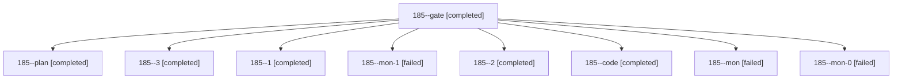

# Session: 185

[Agent Hoods](../README.md) / [bbugyi200](../users/bbugyi200/README.md) / [athena](../users/bbugyi200/machines/athena/README.md) / [185](../users/bbugyi200/machines/athena/hoods/185/README.md) / 185

Owner: `bbugyi200.athena` · Hood: `185` · Members: 9

## Lineage



The diagram is an optional enhancement; the ordered table below contains the same lineage in accessible text.

| Role | Agent | State | Model / provider | Timing | Commits | Prompt | Chat |
|---|---|---|---|---|---:|---|---|
| <a id="member-gate"></a>gate | 185--gate | completed | opus / claude | 2026-11-04T19:03:12.251755+00:00 → 2026-11-04T19:03:59.363384+00:00 | 0 | — | [Chat](../agents/bbugyi200.athena.185--gate/chat.md) |
| <a id="member-plan"></a>plan | 185--plan | completed | opus / claude | 2026-11-04T18:52:24.830660+00:00 → 2026-11-04T19:02:32.928376+00:00 | 0 | [Prompt](../agents/bbugyi200.athena.185--plan/prompt.md) | [Chat](../agents/bbugyi200.athena.185--plan/chat.md) |
| <a id="member-3"></a>3 | 185--3 | completed | gpt-6-luna / codex | 2026-11-04T20:09:57.194178+00:00 → 2026-11-04T20:40:24.730603+00:00 | [1](../agents/bbugyi200.athena.185--3/README.md#commits) | [Prompt](../agents/bbugyi200.athena.185--3/prompt.md) | [Chat](../agents/bbugyi200.athena.185--3/chat.md) |
| <a id="member-1"></a>1 | 185--1 | completed | gpt-6-luna / codex | 2026-11-04T19:47:13.025089+00:00 → 2026-11-04T19:48:41.401171+00:00 | 0 | [Prompt](../agents/bbugyi200.athena.185--1/prompt.md) | [Chat](../agents/bbugyi200.athena.185--1/chat.md) |
| <a id="member-mon-1"></a>mon-1 | 185--mon-1 | failed | gpt-6-luna / codex | 2026-11-04T19:57:29.034890+00:00 → 2026-11-04T20:09:08.270856+00:00 | 0 | — | [Chat](../agents/bbugyi200.athena.185--mon-1/chat.md) |
| <a id="member-2"></a>2 | 185--2 | completed | gpt-6-luna / codex | 2026-11-04T19:53:53.660916+00:00 → 2026-11-04T19:58:21.953203+00:00 | 0 | [Prompt](../agents/bbugyi200.athena.185--2/prompt.md) | [Chat](../agents/bbugyi200.athena.185--2/chat.md) |
| <a id="member-code"></a>code | 185--code | completed | gpt-6-luna / codex | 2026-11-04T19:04:36.594435+00:00 → 2026-11-04T19:44:49.357454+00:00 | 0 | [Prompt](../agents/bbugyi200.athena.185--code/prompt.md) | [Chat](../agents/bbugyi200.athena.185--code/chat.md) |
| <a id="member-mon"></a>mon | 185--mon | failed | gpt-6-luna / codex | 2026-11-04T19:43:52.138663+00:00 → 2026-11-04T19:46:21.187515+00:00 | 0 | — | [Chat](../agents/bbugyi200.athena.185--mon/chat.md) |
| <a id="member-mon-0"></a>mon-0 | 185--mon-0 | failed | gpt-6-luna / codex | 2026-11-04T19:47:57.144661+00:00 → 2026-11-04T19:52:19.168726+00:00 | 0 | — | [Chat](../agents/bbugyi200.athena.185--mon-0/chat.md) |

## Commits

| Role | Repo | Commit | Subject | Committed |
|---|---|---|---|---|
| 3 | bob-cli | [`d520909`](https://github.com/bobs-org/bob-cli/commit/d520909df132854e60a18293e7fce1304f0b35b2) | feat(capture): add route sigil alias rewrite | 2026-11-04 15:25:56 EST |

## Variables

| Role | Variable | Value |
|---|---|---|
| 3 | `artifacts` | \[{kind: markdown, label: Reproducible note-pull CLI preview fixture failure, path: /home/bryan/.sase/artifacts/agents/gh\_bobs-org\_\_bob-cli/20261104150808/note-pull-preview-fixture-failure-3c266b390b2… |

#### artifacts

**Role:** `3`

```yaml
- kind: markdown
  label: Reproducible note-pull CLI preview fixture failure
  path: /home/bryan/.sase/artifacts/agents/gh_bobs-org__bob-cli/20261104150808/note-pull-preview-fixture-failure-3c266b390b21.md
  ref: file:explicit:9a230faf1bf5838cdee42574
```

Values are truncated for display; see each member's agent meta.json for the full values.

## Neighbors

| Agent | Relation | State |
|---|---|---|
| [185.f0](bbugyi200.athena.185.f0.md) (session · 3) | descendant | completed 3 |
| [185.f0.f0](../agents/bbugyi200.athena.185.f0.f0/README.md) | descendant | active |
| [185.f0.f1](bbugyi200.athena.185.f0.f1.md) (session · 3) | descendant | completed 3 |
| [185.f0.f2](bbugyi200.athena.185.f0.f2.md) (session · 3) | descendant | completed 3 |
| [185.f0.f2.f0](bbugyi200.athena.185.f0.f2.f0.md) (session · 5) | descendant | active 1, completed 3, failed 1 |
| [185.f0.f2.f0.f0](../agents/bbugyi200.athena.185.f0.f2.f0.f0/README.md) | descendant | waiting |
