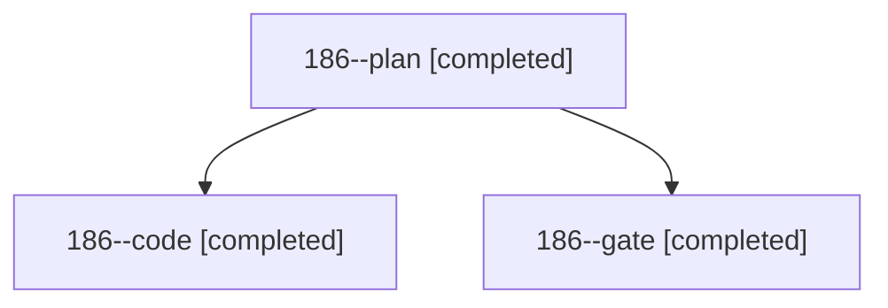

# Session: 186

[Agent Hoods](../README.md) / [bbugyi200](../users/bbugyi200/README.md) / [athena](../users/bbugyi200/machines/athena/README.md) / [186](../users/bbugyi200/machines/athena/hoods/186/README.md) / 186

Owner: `bbugyi200.athena` · Hood: `186` · Members: 3

## Lineage

The diagram is an optional enhancement; the ordered table below contains the same lineage in accessible text.

| Role | Agent | State | Model / provider | Timing | Commits | Prompt | Chat |
|---|---|---|---|---|---:|---|---|
| plan | 186--plan | completed | opus / claude | 2026-11-04T19:11:46.550791+00:00 → 2026-11-04T19:18:06.238709+00:00 | 0 | [Prompt](../agents/bbugyi200.athena.186--plan/prompt.md) | [Chat](../agents/bbugyi200.athena.186--plan/chat.md) |
| code | 186--code | completed | muse-spark-1.3-contributor / muse | 2026-11-04T19:24:17.953474+00:00 → 2026-11-04T19:51:00.473511+00:00 | [1](../agents/bbugyi200.athena.186--code/README.md#commits) | [Prompt](../agents/bbugyi200.athena.186--code/prompt.md) | — |
| gate | 186--gate | completed | opus / claude | 2026-11-04T19:22:40.027124+00:00 → 2026-11-04T19:23:39.909188+00:00 | 0 | — | [Chat](../agents/bbugyi200.athena.186--gate/chat.md) |

## Commits

| Role | Repo | Commit | Subject | Committed |
|---|---|---|---|---|
| code | bob-cli | [`87eecb1`](https://github.com/bobs-org/bob-cli/commit/87eecb1a9e3ce7dd9616aacd117c062094066e2c) | feat(capture): list only closed tasks under capture-complete -C for task\_goto | 2026-11-04 14:50:32 EST |
