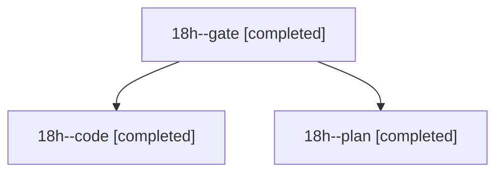

# Session: 18h

[Agent Hoods](../README.md) / [bbugyi200](../users/bbugyi200/README.md) / [athena](../users/bbugyi200/machines/athena/README.md) / [18h](../users/bbugyi200/machines/athena/hoods/18h/README.md) / 18h

Owner: `bbugyi200.athena` · Hood: `18h` · Members: 3

## Lineage

The diagram is an optional enhancement; the ordered table below contains the same lineage in accessible text.

| Role | Agent | State | Model / provider | Timing | Commits | Prompt | Chat |
|---|---|---|---|---|---:|---|---|
| gate | 18h--gate | completed | opus / claude | 2026-11-05T12:10:52.075401+00:00 → 2026-11-05T12:11:41.322853+00:00 | 0 | — | [Chat](../agents/bbugyi200.athena.18h--gate/chat.md) |
| code | 18h--code | completed | gpt-6-luna / codex | 2026-11-05T12:12:18.521692+00:00 → 2026-11-05T12:39:02.693215+00:00 | 0 | [Prompt](../agents/bbugyi200.athena.18h--code/prompt.md) | [Chat](../agents/bbugyi200.athena.18h--code/chat.md) |
| plan | 18h--plan | completed | opus / claude | 2026-11-05T11:48:33.975026+00:00 → 2026-11-05T12:10:17.229578+00:00 | 0 | [Prompt](../agents/bbugyi200.athena.18h--plan/prompt.md) | [Chat](../agents/bbugyi200.athena.18h--plan/chat.md) |
