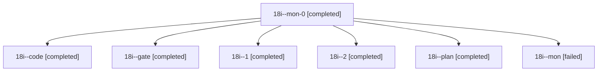

# Session: 18i

[Agent Hoods](../README.md) / [bbugyi200](../users/bbugyi200/README.md) / [athena](../users/bbugyi200/machines/athena/README.md) / [18i](../users/bbugyi200/machines/athena/hoods/18i/README.md) / 18i

Owner: `bbugyi200.athena` · Hood: `18i` · Members: 7

## Lineage



The diagram is an optional enhancement; the ordered table below contains the same lineage in accessible text.

| Role | Agent | State | Model / provider | Timing | Commits | Prompt | Chat |
|---|---|---|---|---|---:|---|---|
| <a id="member-mon-0"></a>mon-0 | 18i--mon-0 | completed | gpt-6-luna / codex | 2026-11-05T14:55:35.653774+00:00 → 2026-11-05T15:06:01.529044+00:00 | 0 | — | [Chat](../agents/bbugyi200.athena.18i--mon-0/chat.md) |
| <a id="member-code"></a>code | 18i--code | completed | gpt-6-luna / codex | 2026-11-05T13:36:20.323522+00:00 → 2026-11-05T14:34:29.127295+00:00 | 0 | [Prompt](../agents/bbugyi200.athena.18i--code/prompt.md) | [Chat](../agents/bbugyi200.athena.18i--code/chat.md) |
| <a id="member-gate"></a>gate | 18i--gate | completed | opus / claude | 2026-11-05T13:33:26.081952+00:00 → 2026-11-05T13:35:06.387012+00:00 | 0 | — | [Chat](../agents/bbugyi200.athena.18i--gate/chat.md) |
| <a id="member-1"></a>1 | 18i--1 | completed | gpt-6-luna / codex | 2026-11-05T14:43:14.695460+00:00 → 2026-11-05T14:56:59.693527+00:00 | 0 | [Prompt](../agents/bbugyi200.athena.18i--1/prompt.md) | [Chat](../agents/bbugyi200.athena.18i--1/chat.md) |
| <a id="member-2"></a>2 | 18i--2 | completed | gpt-6-luna / codex | 2026-11-05T15:07:05.749201+00:00 → 2026-11-05T15:10:00.853579+00:00 | [1](../agents/bbugyi200.athena.18i--2/README.md#commits) | [Prompt](../agents/bbugyi200.athena.18i--2/prompt.md) | [Chat](../agents/bbugyi200.athena.18i--2/chat.md) |
| <a id="member-plan"></a>plan | 18i--plan | completed | opus / claude | 2026-11-05T13:23:45.134076+00:00 → 2026-11-05T13:32:30.633491+00:00 | 0 | [Prompt](../agents/bbugyi200.athena.18i--plan/prompt.md) | [Chat](../agents/bbugyi200.athena.18i--plan/chat.md) |
| <a id="member-mon"></a>mon | 18i--mon | failed | gpt-6-luna / codex | 2026-11-05T14:33:14.297275+00:00 → 2026-11-05T14:42:06.624786+00:00 | 0 | — | [Chat](../agents/bbugyi200.athena.18i--mon/chat.md) |

## Commits

| Role | Repo | Commit | Subject | Committed |
|---|---|---|---|---|
| 2 | bob-cli | [`bb8d47e`](https://github.com/bobs-org/bob-cli/commit/bb8d47e9ed7ab49717e23027fda76093b5108f97) | feat(gcal): refile moved meetings after Google updates | 2026-11-05 10:09:45 EST |

## Variables

| Role | Variable | Value |
|---|---|---|
| code | `artifacts` | \[{bead: bob-cli-ha, kind: markdown, label: First-day tutorial source with retired capture syntax, path: /home/bryan/.sase/artifacts/agents/gh\_bobs-org\_\_bob-cli/20261105083505/first-bob-day-24f8fa723b… |

#### artifacts

**Role:** `code`

```yaml
- bead: bob-cli-ha
  kind: markdown
  label: First-day tutorial source with retired capture syntax
  path: /home/bryan/.sase/artifacts/agents/gh_bobs-org__bob-cli/20261105083505/first-bob-day-24f8fa723b0f.md
  ref: file:explicit:eaf3c3a97cb043b51c41c712
  source_path: /home/bryan/.local/state/sase/workspaces/bobs-org/bob-cli/bob-cli_26/docs/start/first-bob-day.md
```

Values are truncated for display; see each member's agent meta.json for the full values.
