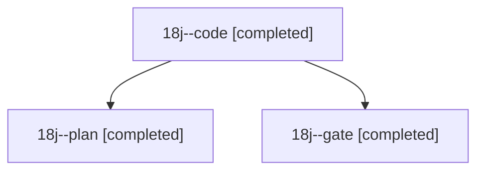

# Session: 18j

[Agent Hoods](../README.md) / [bbugyi200](../users/bbugyi200/README.md) / [athena](../users/bbugyi200/machines/athena/README.md) / [18j](../users/bbugyi200/machines/athena/hoods/18j/README.md) / 18j

Owner: `bbugyi200.athena` · Hood: `18j` · Members: 3

## Lineage

The diagram is an optional enhancement; the ordered table below contains the same lineage in accessible text.

| Role | Agent | State | Model / provider | Timing | Commits | Prompt | Chat |
|---|---|---|---|---|---:|---|---|
| code | 18j--code | completed | muse-spark-1.3-contributor / muse | 2026-11-05T13:46:32.103580+00:00 → 2026-11-05T14:32:56.821162+00:00 | [1](../agents/bbugyi200.athena.18j--code/README.md#commits) | [Prompt](../agents/bbugyi200.athena.18j--code/prompt.md) | [Chat](../agents/bbugyi200.athena.18j--code/chat.md) |
| plan | 18j--plan | completed | opus / claude | 2026-11-05T13:32:47.478352+00:00 → 2026-11-05T13:42:43.558054+00:00 | 0 | [Prompt](../agents/bbugyi200.athena.18j--plan/prompt.md) | [Chat](../agents/bbugyi200.athena.18j--plan/chat.md) |
| gate | 18j--gate | completed | opus / claude | 2026-11-05T13:42:41.469551+00:00 → 2026-11-05T13:45:55.924332+00:00 | 0 | — | [Chat](../agents/bbugyi200.athena.18j--gate/chat.md) |

## Commits

| Role | Repo | Commit | Subject | Committed |
|---|---|---|---|---|
| code | bob-cli | [`1a5c9b0`](https://github.com/bobs-org/bob-cli/commit/1a5c9b008b749e8fc5ee40dc27505c395e33c910) | feat(plan): leave off-clock Task Links out of the link budget | 2026-11-05 09:32:17 EST |
