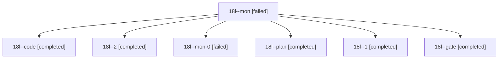

# Session: 18l

[Agent Hoods](../README.md) / [bbugyi200](../users/bbugyi200/README.md) / [athena](../users/bbugyi200/machines/athena/README.md) / [18l](../users/bbugyi200/machines/athena/hoods/18l/README.md) / 18l

Owner: `bbugyi200.athena` · Hood: `18l` · Members: 7

## Lineage



The diagram is an optional enhancement; the ordered table below contains the same lineage in accessible text.

| Role | Agent | State | Model / provider | Timing | Commits | Prompt | Chat |
|---|---|---|---|---|---:|---|---|
| <a id="member-mon"></a>mon | 18l--mon | failed | gpt-6-luna / codex | 2026-11-05T15:13:07.214681+00:00 → 2026-11-05T15:37:12.558856+00:00 | 0 | — | [Chat](../agents/bbugyi200.athena.18l--mon/chat.md) |
| <a id="member-code"></a>code | 18l--code | completed | gpt-6-luna / codex | 2026-11-05T14:55:41.963156+00:00 → 2026-11-05T15:31:20.583599+00:00 | 0 | [Prompt](../agents/bbugyi200.athena.18l--code/prompt.md) | [Chat](../agents/bbugyi200.athena.18l--code/chat.md) |
| <a id="member-2"></a>2 | 18l--2 | completed | gpt-6-luna / codex | 2026-11-05T15:55:27.049876+00:00 → 2026-11-05T15:59:56.906339+00:00 | [1](../agents/bbugyi200.athena.18l--2/README.md#commits) | [Prompt](../agents/bbugyi200.athena.18l--2/prompt.md) | [Chat](../agents/bbugyi200.athena.18l--2/chat.md) |
| <a id="member-mon-0"></a>mon-0 | 18l--mon-0 | failed | gpt-6-luna / codex | 2026-11-05T15:44:45.641505+00:00 → 2026-11-05T15:53:33.612242+00:00 | 0 | — | [Chat](../agents/bbugyi200.athena.18l--mon-0/chat.md) |
| <a id="member-plan"></a>plan | 18l--plan | completed | opus / claude | 2026-11-05T14:39:27.509481+00:00 → 2026-11-05T14:49:23.718612+00:00 | 0 | [Prompt](../agents/bbugyi200.athena.18l--plan/prompt.md) | [Chat](../agents/bbugyi200.athena.18l--plan/chat.md) |
| <a id="member-1"></a>1 | 18l--1 | completed | gpt-6-luna / codex | 2026-11-05T15:38:22.484628+00:00 → 2026-11-05T15:45:25.019887+00:00 | 0 | [Prompt](../agents/bbugyi200.athena.18l--1/prompt.md) | [Chat](../agents/bbugyi200.athena.18l--1/chat.md) |
| <a id="member-gate"></a>gate | 18l--gate | completed | opus / claude | 2026-11-05T14:53:27.502957+00:00 → 2026-11-05T14:54:24.942631+00:00 | 0 | — | [Chat](../agents/bbugyi200.athena.18l--gate/chat.md) |

## Commits

| Role | Repo | Commit | Subject | Committed |
|---|---|---|---|---|
| 2 | bob-cli | [`344c097`](https://github.com/bobs-org/bob-cli/commit/344c0973738215013e27d0e68843e1690fc5a793) | feat(task-status-hooks): coalesce credit-neutral Pomodoro sessions | 2026-11-05 10:59:44 EST |

## Variables

| Role | Variable | Value |
|---|---|---|
| code | `artifacts` | \[{kind: markdown, label: First-day tutorial syntax rejected by docs-check, path: /home/bryan/.sase/artifacts/agents/gh\_bobs-org\_\_bob-cli/20261105095424/first-bob-day-24f8fa723b0f.md, ref: file:explic… |

#### artifacts

**Role:** `code`

```yaml
- kind: markdown
  label: First-day tutorial syntax rejected by docs-check
  path: /home/bryan/.sase/artifacts/agents/gh_bobs-org__bob-cli/20261105095424/first-bob-day-24f8fa723b0f.md
  ref: file:explicit:6345255633fd8a37d63b4663
  source_path: /home/bryan/.local/state/sase/workspaces/bobs-org/bob-cli/bob-cli_29/docs/start/first-bob-day.md
```

Values are truncated for display; see each member's agent meta.json for the full values.
