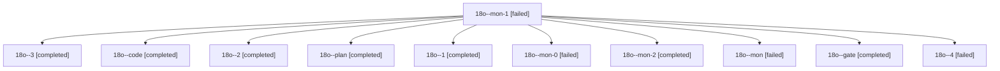

# Session: 18o

[Agent Hoods](../README.md) / [bbugyi200](../users/bbugyi200/README.md) / [athena](../users/bbugyi200/machines/athena/README.md) / [18o](../users/bbugyi200/machines/athena/hoods/18o/README.md) / 18o

Owner: `bbugyi200.athena` · Hood: `18o` · Members: 11

## Lineage

The diagram is an optional enhancement; the ordered table below contains the same lineage in accessible text.

| Role | Agent | State | Model / provider | Timing | Commits | Prompt | Chat |
|---|---|---|---|---|---:|---|---|
| mon-1 | 18o--mon-1 | failed | gpt-6-luna / codex | 2026-11-05T19:40:38.598927+00:00 → 2026-11-05T19:53:02.446773+00:00 | 0 | — | [Chat](../agents/bbugyi200.athena.18o--mon-1/chat.md) |
| 3 | 18o--3 | completed | gpt-6-luna / codex | 2026-11-05T19:54:58.818490+00:00 → 2026-11-05T19:59:57.425851+00:00 | 0 | [Prompt](../agents/bbugyi200.athena.18o--3/prompt.md) | [Chat](../agents/bbugyi200.athena.18o--3/chat.md) |
| code | 18o--code | completed | gpt-6-luna / codex | 2026-11-05T18:25:38.604804+00:00 → 2026-11-05T19:01:22.338047+00:00 | 0 | [Prompt](../agents/bbugyi200.athena.18o--code/prompt.md) | [Chat](../agents/bbugyi200.athena.18o--code/chat.md) |
| 2 | 18o--2 | completed | gpt-6-luna / codex | 2026-11-05T19:35:39.215646+00:00 → 2026-11-05T19:41:16.122960+00:00 | 0 | [Prompt](../agents/bbugyi200.athena.18o--2/prompt.md) | [Chat](../agents/bbugyi200.athena.18o--2/chat.md) |
| plan | 18o--plan | completed | opus / claude | 2026-11-05T18:13:47.477466+00:00 → 2026-11-05T18:21:33.184713+00:00 | 0 | [Prompt](../agents/bbugyi200.athena.18o--plan/prompt.md) | [Chat](../agents/bbugyi200.athena.18o--plan/chat.md) |
| 1 | 18o--1 | completed | gpt-6-luna / codex | 2026-11-05T19:17:20.248161+00:00 → 2026-11-05T19:25:41.234040+00:00 | 0 | [Prompt](../agents/bbugyi200.athena.18o--1/prompt.md) | [Chat](../agents/bbugyi200.athena.18o--1/chat.md) |
| mon-0 | 18o--mon-0 | failed | gpt-6-luna / codex | 2026-11-05T19:24:25.896546+00:00 → 2026-11-05T19:34:31.852860+00:00 | 0 | — | [Chat](../agents/bbugyi200.athena.18o--mon-0/chat.md) |
| mon-2 | 18o--mon-2 | completed | gpt-6-luna / codex | 2026-11-05T19:59:23.991732+00:00 → 2026-11-05T20:04:46.111163+00:00 | 0 | — | [Chat](../agents/bbugyi200.athena.18o--mon-2/chat.md) |
| mon | 18o--mon | failed | gpt-6-luna / codex | 2026-11-05T19:00:00.617834+00:00 → 2026-11-05T19:15:18.509897+00:00 | 0 | — | [Chat](../agents/bbugyi200.athena.18o--mon/chat.md) |
| gate | 18o--gate | completed | opus / claude | 2026-11-05T18:23:38.807611+00:00 → 2026-11-05T18:24:42.458750+00:00 | 0 | — | [Chat](../agents/bbugyi200.athena.18o--gate/chat.md) |
| 4 | 18o--4 | failed | muse-spark-1.3-contributor / muse | 2026-11-05T20:05:49.963434+00:00 → 2026-11-05T20:19:27.605441+00:00 | [1](../agents/bbugyi200.athena.18o--4/README.md#commits) | [Prompt](../agents/bbugyi200.athena.18o--4/prompt.md) | — |

## Commits

| Role | Repo | Commit | Subject | Committed |
|---|---|---|---|---|
| 4 | bob-cli | [`16c6356`](https://github.com/bobs-org/bob-cli/commit/16c6356df0c028e4001d23b31b0375d37caa045a) | feat(close): implement explicit close-selection any-number with keep-clock | 2026-11-05 15:17:40 EST |
