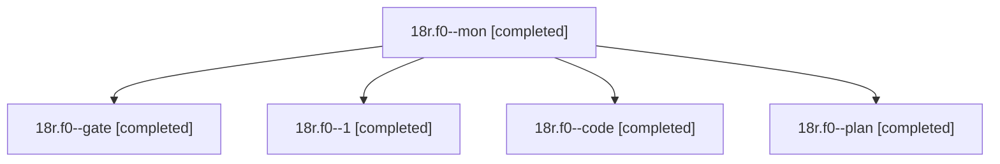

# Session: 18r.f0

[Agent Hoods](../README.md) / [bbugyi200](../users/bbugyi200/README.md) / [athena](../users/bbugyi200/machines/athena/README.md) / [18r](../users/bbugyi200/machines/athena/hoods/18r/README.md) / 18r.f0

Owner: `bbugyi200.athena` · Hood: `18r` · Members: 5

## Lineage

The diagram is an optional enhancement; the ordered table below contains the same lineage in accessible text.

| Role | Agent | State | Model / provider | Timing | Commits | Prompt | Chat |
|---|---|---|---|---|---:|---|---|
| mon | 18r.f0--mon | completed | muse-spark-1.3-contributor / muse | 2026-11-05T22:30:44.707003+00:00 → 2026-11-05T22:39:43.903942+00:00 | 0 | — | [Chat](../agents/bbugyi200.athena.18r.f0--mon/chat.md) |
| gate | 18r.f0--gate | completed | opus / claude | 2026-11-05T21:54:16.039814+00:00 → 2026-11-05T21:55:27.109240+00:00 | 0 | — | [Chat](../agents/bbugyi200.athena.18r.f0--gate/chat.md) |
| 1 | 18r.f0--1 | completed | muse-spark-1.3-contributor / muse | 2026-11-05T22:41:24.543584+00:00 → 2026-11-05T22:43:29.990869+00:00 | [1](../agents/bbugyi200.athena.18r.f0--1/README.md#commits) | [Prompt](../agents/bbugyi200.athena.18r.f0--1/prompt.md) | [Chat](../agents/bbugyi200.athena.18r.f0--1/chat.md) |
| code | 18r.f0--code | completed | muse-spark-1.3-contributor / muse | 2026-11-05T21:56:34.422950+00:00 → 2026-11-05T22:32:14.973784+00:00 | 0 | [Prompt](../agents/bbugyi200.athena.18r.f0--code/prompt.md) | [Chat](../agents/bbugyi200.athena.18r.f0--code/chat.md) |
| plan | 18r.f0--plan | completed | opus / claude | 2026-11-05T21:43:03.698621+00:00 → 2026-11-05T21:53:28.673486+00:00 | 0 | [Prompt](../agents/bbugyi200.athena.18r.f0--plan/prompt.md) | [Chat](../agents/bbugyi200.athena.18r.f0--plan/chat.md) |

## Commits

| Role | Repo | Commit | Subject | Committed |
|---|---|---|---|---|
| 1 | bob-cli | [`7c71241`](https://github.com/bobs-org/bob-cli/commit/7c71241fcc8318a6871c09046e63524eb5e929f6) | feat(capture): flip relation direction with = anywhere in filter | 2026-11-05 17:42:51 EST |

## Neighbors

| Agent | Relation | State |
|---|---|---|
| [18r](bbugyi200.athena.18r.md) (session · 7) | ancestor | completed 5, failed 2 |
