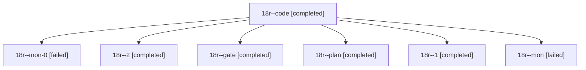

# Session: 18r

[Agent Hoods](../README.md) / [bbugyi200](../users/bbugyi200/README.md) / [athena](../users/bbugyi200/machines/athena/README.md) / [18r](../users/bbugyi200/machines/athena/hoods/18r/README.md) / 18r

Owner: `bbugyi200.athena` · Hood: `18r` · Members: 7

## Lineage



The diagram is an optional enhancement; the ordered table below contains the same lineage in accessible text.

| Role | Agent | State | Model / provider | Timing | Commits | Prompt | Chat |
|---|---|---|---|---|---:|---|---|
| <a id="member-code"></a>code | 18r--code | completed | gpt-6-luna / codex | 2026-11-05T19:20:17.260657+00:00 → 2026-11-05T20:18:42.659847+00:00 | 0 | [Prompt](../agents/bbugyi200.athena.18r--code/prompt.md) | [Chat](../agents/bbugyi200.athena.18r--code/chat.md) |
| <a id="member-mon-0"></a>mon-0 | 18r--mon-0 | failed | gpt-6-luna / codex | 2026-11-05T20:46:02.423555+00:00 → 2026-11-05T21:03:56.733878+00:00 | 0 | — | [Chat](../agents/bbugyi200.athena.18r--mon-0/chat.md) |
| <a id="member-2"></a>2 | 18r--2 | completed | gpt-6-luna / codex | 2026-11-05T21:04:50.706922+00:00 → 2026-11-05T21:13:00.920807+00:00 | [1](../agents/bbugyi200.athena.18r--2/README.md#commits) | [Prompt](../agents/bbugyi200.athena.18r--2/prompt.md) | [Chat](../agents/bbugyi200.athena.18r--2/chat.md) |
| <a id="member-gate"></a>gate | 18r--gate | completed | opus / claude | 2026-11-05T19:02:04.588423+00:00 → 2026-11-05T19:06:09.938572+00:00 | 0 | — | [Chat](../agents/bbugyi200.athena.18r--gate/chat.md) |
| <a id="member-plan"></a>plan | 18r--plan | completed | opus / claude | 2026-11-05T18:50:26.419120+00:00 → 2026-11-05T19:02:06.404160+00:00 | 0 | [Prompt](../agents/bbugyi200.athena.18r--plan/prompt.md) | [Chat](../agents/bbugyi200.athena.18r--plan/chat.md) |
| <a id="member-1"></a>1 | 18r--1 | completed | gpt-6-luna / codex | 2026-11-05T20:39:03.291255+00:00 → 2026-11-05T20:46:58.857181+00:00 | 0 | [Prompt](../agents/bbugyi200.athena.18r--1/prompt.md) | [Chat](../agents/bbugyi200.athena.18r--1/chat.md) |
| <a id="member-mon"></a>mon | 18r--mon | failed | gpt-6-luna / codex | 2026-11-05T20:17:40.825550+00:00 → 2026-11-05T20:37:49.249756+00:00 | 0 | — | [Chat](../agents/bbugyi200.athena.18r--mon/chat.md) |

## Commits

| Role | Repo | Commit | Subject | Committed |
|---|---|---|---|---|
| 2 | bob-cli | [`060d97e`](https://github.com/bobs-org/bob-cli/commit/060d97ed6919e2662da0952d9030766407bac5ff) | feat(capture): add relation dash rewrite aliases | 2026-11-05 16:12:36 EST |

## Variables

| Role | Variable | Value |
|---|---|---|
| code | `artifacts` | \[{bead: bob-cli-24, kind: file, label: just lint residual failures after relation-dash implementation, path: /home/bryan/.sase/artifacts/agents/gh\_bobs-org\_\_bob-cli/20261105140609/bob-cli-relation-da… |

#### artifacts

**Role:** `code`

```yaml
- bead: bob-cli-24
  kind: file
  label: just lint residual failures after relation-dash implementation
  path: /home/bryan/.sase/artifacts/agents/gh_bobs-org__bob-cli/20261105140609/bob-cli-relation-dash-lint-evidence-67a8d3e36711.txt
  ref: file:explicit:30cd9d60cfa6efcdb1acf197
  source_path: /tmp/bob-cli-relation-dash-lint-evidence.txt
- bead: bob-cli-h7
  kind: file
  label: master Mac CI baseline for relation dash alias plan
  path: /home/bryan/.sase/artifacts/agents/gh_bobs-org__bob-cli/20261105140609/bob-mac-ci-baseline-h7-evidence-213f700d3575.txt
  ref: file:explicit:2ddc54ea7b2c3c3427488ee5
  source_path: /tmp/bob-mac-ci-baseline-h7-evidence.txt
```

Values are truncated for display; see each member's agent meta.json for the full values.
