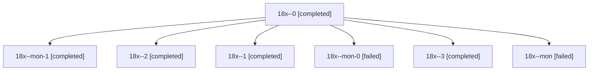

# Session: 18x

[Agent Hoods](../README.md) / [bbugyi200](../users/bbugyi200/README.md) / [athena](../users/bbugyi200/machines/athena/README.md) / [18x](../users/bbugyi200/machines/athena/hoods/18x/README.md) / 18x

Owner: `bbugyi200.athena` · Hood: `18x` · Members: 7

## Lineage

The diagram is an optional enhancement; the ordered table below contains the same lineage in accessible text.

| Role | Agent | State | Model / provider | Timing | Commits | Prompt | Chat |
|---|---|---|---|---|---:|---|---|
| 0 | 18x--0 | completed | gpt-6-astra / codex | 2026-11-05T21:52:10.246349+00:00 → 2026-11-05T22:04:55.117355+00:00 | 0 | [Prompt](../agents/bbugyi200.athena.18x--0/prompt.md) | [Chat](../agents/bbugyi200.athena.18x--0/chat.md) |
| mon-1 | 18x--mon-1 | completed | gpt-6-astra / codex | 2026-11-05T22:27:49.197212+00:00 → 2026-11-05T22:39:25.406925+00:00 | 0 | — | [Chat](../agents/bbugyi200.athena.18x--mon-1/chat.md) |
| 2 | 18x--2 | completed | gpt-6-astra / codex | 2026-11-05T22:25:21.286663+00:00 → 2026-11-05T22:28:30.346278+00:00 | 0 | [Prompt](../agents/bbugyi200.athena.18x--2/prompt.md) | [Chat](../agents/bbugyi200.athena.18x--2/chat.md) |
| 1 | 18x--1 | completed | gpt-6-astra / codex | 2026-11-05T22:09:47.757629+00:00 → 2026-11-05T22:12:40.166541+00:00 | 0 | [Prompt](../agents/bbugyi200.athena.18x--1/prompt.md) | [Chat](../agents/bbugyi200.athena.18x--1/chat.md) |
| mon-0 | 18x--mon-0 | failed | gpt-6-astra / codex | 2026-11-05T22:12:04.459327+00:00 → 2026-11-05T22:23:01.393133+00:00 | 0 | — | [Chat](../agents/bbugyi200.athena.18x--mon-0/chat.md) |
| 3 | 18x--3 | completed | gpt-6-astra / codex | 2026-11-05T22:41:07.866716+00:00 → 2026-11-05T22:42:34.115838+00:00 | [1](../agents/bbugyi200.athena.18x--3/README.md#commits) | [Prompt](../agents/bbugyi200.athena.18x--3/prompt.md) | [Chat](../agents/bbugyi200.athena.18x--3/chat.md) |
| mon | 18x--mon | failed | gpt-6-astra / codex | 2026-11-05T22:04:09.550231+00:00 → 2026-11-05T22:08:16.555827+00:00 | 0 | — | [Chat](../agents/bbugyi200.athena.18x--mon/chat.md) |

## Commits

| Role | Repo | Commit | Subject | Committed |
|---|---|---|---|---|
| 3 | bob-cli | [`06d6c32`](https://github.com/bobs-org/bob-cli/commit/06d6c32e4220f0a16e3c7a3e4d855e9593a74d8a) | feat(capture)!: complete explicit close-selection coverage | 2026-11-05 17:42:10 EST |
