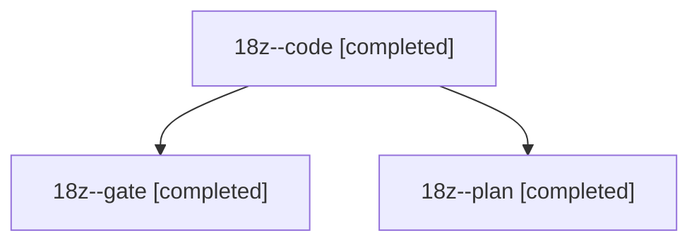

# Session: 18z

[Agent Hoods](../README.md) / [bbugyi200](../users/bbugyi200/README.md) / [athena](../users/bbugyi200/machines/athena/README.md) / [18z](../users/bbugyi200/machines/athena/hoods/18z/README.md) / 18z

Owner: `bbugyi200.athena` · Hood: `18z` · Members: 3

## Lineage

The diagram is an optional enhancement; the ordered table below contains the same lineage in accessible text.

| Role | Agent | State | Model / provider | Timing | Commits | Prompt | Chat |
|---|---|---|---|---|---:|---|---|
| code | 18z--code | completed | gpt-6-luna / codex | 2026-11-05T23:01:50.801412+00:00 → 2026-11-05T23:35:37.154894+00:00 | 0 | [Prompt](../agents/bbugyi200.athena.18z--code/prompt.md) | [Chat](../agents/bbugyi200.athena.18z--code/chat.md) |
| gate | 18z--gate | completed | opus / claude | 2026-11-05T22:59:45.393584+00:00 → 2026-11-05T23:01:08.230532+00:00 | 0 | — | [Chat](../agents/bbugyi200.athena.18z--gate/chat.md) |
| plan | 18z--plan | completed | opus / claude | 2026-11-05T22:43:01.096253+00:00 → 2026-11-05T22:55:54.711025+00:00 | 0 | [Prompt](../agents/bbugyi200.athena.18z--plan/prompt.md) | [Chat](../agents/bbugyi200.athena.18z--plan/chat.md) |
