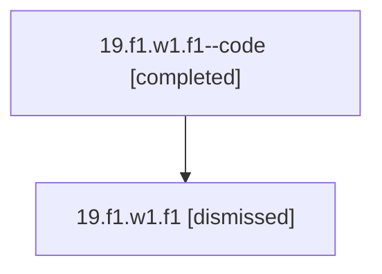

# Session: 19.f1.w1.f1

[Agent Hoods](../README.md) / [bbugyi200](../users/bbugyi200/README.md) / [athena](../users/bbugyi200/machines/athena/README.md) / [19](../users/bbugyi200/machines/athena/hoods/19/README.md) / 19.f1.w1.f1

Owner: `bbugyi200.athena` · Hood: `19` · Members: 2

## Lineage

The diagram is an optional enhancement; the ordered table below contains the same lineage in accessible text.

| Role | Agent | State | Model / provider | Timing | Commits | Prompt | Chat |
|---|---|---|---|---|---:|---|---|
| code | 19.f1.w1.f1--code | completed | gpt-5.5 / codex | 2026-07-08T00:33:44.908873+00:00 | 0 | — | [Chat](../agents/bbugyi200.athena.19.f1.w1.f1--code/chat.md) |
| root | 19.f1.w1.f1 | dismissed | opus / claude | 2026-07-07T20:11:29.588464 → 2026-07-07T20:38:05.692204 | [1](../agents/bbugyi200.athena.19.f1.w1.f1/README.md#commits) | [Prompt](../agents/bbugyi200.athena.19.f1.w1.f1/prompt.md) | [Chat](../agents/bbugyi200.athena.19.f1.w1.f1/chat.md) |

## Commits

| Role | Repo | Commit | Subject | Committed |
|---|---|---|---|---|
| root | — | `08d0d77` | chore: Add SDD prompt and plan for fix\_counted\_transclusion\_keymaps | 2026-07-07 20:33:42 EDT |
| — | — | `7f6faed` | chore: Mark SDD plan done | 2026-07-08 12:38:04 EDT |

## Neighbors

| Agent | Relation | State |
|---|---|---|
| [19.f1.w1](bbugyi200.athena.19.f1.w1.md) (session · 2) | ancestor | completed 1, dismissed 1 |
| [19.f1](bbugyi200.athena.19.f1.md) (session · 2) | ancestor | completed 1, dismissed 1 |
| [19](bbugyi200.athena.19.md) (session · 2) | ancestor | completed 1, dismissed 1 |
