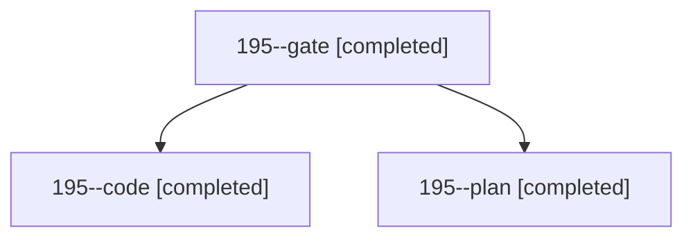

# Session: 195

[Agent Hoods](../README.md) / [bbugyi200](../users/bbugyi200/README.md) / [athena](../users/bbugyi200/machines/athena/README.md) / [195](../users/bbugyi200/machines/athena/hoods/195/README.md) / 195

Owner: `bbugyi200.athena` · Hood: `195` · Members: 3

## Lineage

The diagram is an optional enhancement; the ordered table below contains the same lineage in accessible text.

| Role | Agent | State | Model / provider | Timing | Commits | Prompt | Chat |
|---|---|---|---|---|---:|---|---|
| gate | 195--gate | completed | opus / claude | 2026-11-06T14:48:56.884858+00:00 → 2026-11-06T14:49:58.691471+00:00 | 0 | — | [Chat](../agents/bbugyi200.athena.195--gate/chat.md) |
| code | 195--code | completed | gpt-6-luna / codex | 2026-11-06T14:51:08.702033+00:00 → 2026-11-06T15:07:03.502492+00:00 | 0 | [Prompt](../agents/bbugyi200.athena.195--code/prompt.md) | [Chat](../agents/bbugyi200.athena.195--code/chat.md) |
| plan | 195--plan | completed | opus / claude | 2026-11-06T14:37:12.835574+00:00 → 2026-11-06T14:45:42.719631+00:00 | 0 | [Prompt](../agents/bbugyi200.athena.195--plan/prompt.md) | [Chat](../agents/bbugyi200.athena.195--plan/chat.md) |
