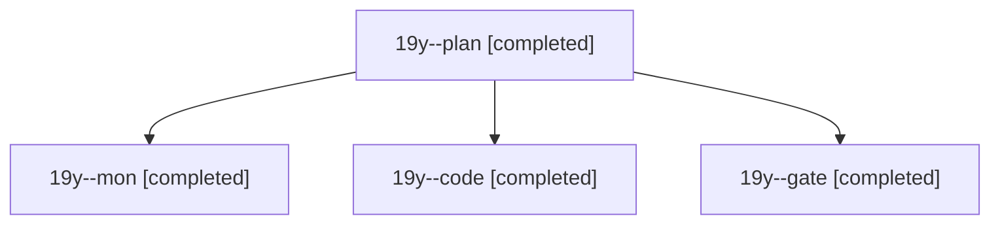

# Session: 19y

[Agent Hoods](../README.md) / [bbugyi200](../users/bbugyi200/README.md) / [athena](../users/bbugyi200/machines/athena/README.md) / [19y](../users/bbugyi200/machines/athena/hoods/19y/README.md) / 19y

Owner: `bbugyi200.athena` · Hood: `19y` · Members: 4

## Lineage

The diagram is an optional enhancement; the ordered table below contains the same lineage in accessible text.

| Role | Agent | State | Model / provider | Timing | Commits | Prompt | Chat |
|---|---|---|---|---|---:|---|---|
| plan | 19y--plan | completed | opus / claude | 2026-11-08T13:52:46.860603+00:00 → 2026-11-08T13:59:37.569944+00:00 | 0 | [Prompt](../agents/bbugyi200.athena.19y--plan/prompt.md) | [Chat](../agents/bbugyi200.athena.19y--plan/chat.md) |
| mon | 19y--mon | completed | grok-4.6 / grok | 2026-11-08T14:35:38.554017+00:00 → 2026-11-08T14:56:22.756185+00:00 | 0 | — | — |
| code | 19y--code | completed | grok-4.6 / grok | 2026-11-08T14:08:26.509231+00:00 → 2026-11-08T14:37:41.760257+00:00 | [1](../agents/bbugyi200.athena.19y--code/README.md#commits) | [Prompt](../agents/bbugyi200.athena.19y--code/prompt.md) | [Chat](../agents/bbugyi200.athena.19y--code/chat.md) |
| gate | 19y--gate | completed | opus / claude | 2026-11-08T14:06:53.815130+00:00 → 2026-11-08T14:07:40.733546+00:00 | 0 | — | [Chat](../agents/bbugyi200.athena.19y--gate/chat.md) |

## Commits

| Role | Repo | Commit | Subject | Committed |
|---|---|---|---|---|
| code | — | `5ed31c1` | docs(relations): document Ctrl+Enter for labelled relations | 2026-11-08 09:36:49 EST |
