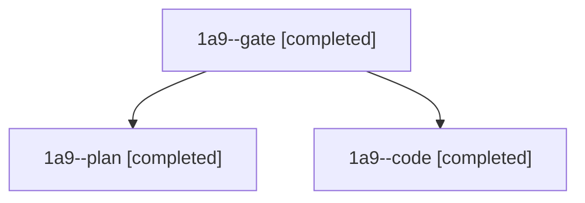

# Session: 1a9

[Agent Hoods](../README.md) / [bbugyi200](../users/bbugyi200/README.md) / [athena](../users/bbugyi200/machines/athena/README.md) / [1a9](../users/bbugyi200/machines/athena/hoods/1a9/README.md) / 1a9

Owner: `bbugyi200.athena` · Hood: `1a9` · Members: 3

## Lineage

The diagram is an optional enhancement; the ordered table below contains the same lineage in accessible text.

| Role | Agent | State | Model / provider | Timing | Commits | Prompt | Chat |
|---|---|---|---|---|---:|---|---|
| gate | 1a9--gate | completed | opus / claude | 2026-11-09T11:26:26.619026+00:00 → 2026-11-09T11:27:22.857395+00:00 | 0 | — | [Chat](../agents/bbugyi200.athena.1a9--gate/chat.md) |
| plan | 1a9--plan | completed | opus / claude | 2026-11-09T11:11:43.465609+00:00 → 2026-11-09T11:18:28.999020+00:00 | 0 | [Prompt](../agents/bbugyi200.athena.1a9--plan/prompt.md) | [Chat](../agents/bbugyi200.athena.1a9--plan/chat.md) |
| code | 1a9--code | completed | grok-4.6 / grok | 2026-11-09T11:28:03.015708+00:00 → 2026-11-09T11:38:55.121990+00:00 | 0 | [Prompt](../agents/bbugyi200.athena.1a9--code/prompt.md) | [Chat](../agents/bbugyi200.athena.1a9--code/chat.md) |
