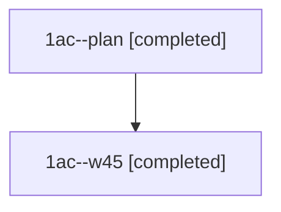

# Session: 1ac

[Agent Hoods](../README.md) / [bbugyi200](../users/bbugyi200/README.md) / [athena](../users/bbugyi200/machines/athena/README.md) / [1ac](../users/bbugyi200/machines/athena/hoods/1ac/README.md) / 1ac

Owner: `bbugyi200.athena` · Hood: `1ac` · Members: 2

## Lineage

The diagram is an optional enhancement; the ordered table below contains the same lineage in accessible text.

| Role | Agent | State | Model / provider | Timing | Commits | Prompt | Chat |
|---|---|---|---|---|---:|---|---|
| plan | 1ac--plan | completed | opus / claude | 2026-11-09T13:53:17.737263+00:00 → 2026-11-09T15:18:09.893603+00:00 | [1](../agents/bbugyi200.athena.1ac--plan/README.md#commits) | [Prompt](../agents/bbugyi200.athena.1ac--plan/prompt.md) | [Chat](../agents/bbugyi200.athena.1ac--plan/chat.md) |
| w45 | 1ac--w45 | completed | opus / claude | 2026-11-09T15:14:16.264898+00:00 → 2026-11-09T15:18:09.893603+00:00 | 0 | — | [Chat](../agents/bbugyi200.athena.1ac--w45/chat.md) |

## Commits

| Role | Repo | Commit | Subject | Committed |
|---|---|---|---|---|
| plan | bob-cli | [`4c09fac`](https://github.com/bobs-org/bob-cli/commit/4c09fac4479f855d04c7a381ff4505c25557bc35) | feat(periods)!: v2 period review instructions and brief v2 | 2026-11-09 10:13:21 EST |
