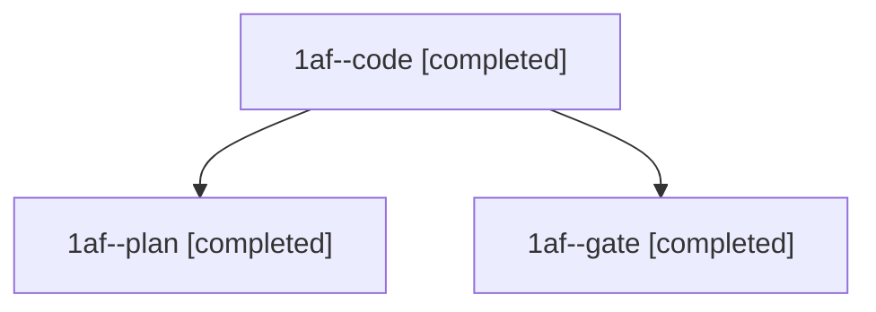

# Session: 1af

[Agent Hoods](../README.md) / [bbugyi200](../users/bbugyi200/README.md) / [athena](../users/bbugyi200/machines/athena/README.md) / [1af](../users/bbugyi200/machines/athena/hoods/1af/README.md) / 1af

Owner: `bbugyi200.athena` · Hood: `1af` · Members: 3

## Lineage

The diagram is an optional enhancement; the ordered table below contains the same lineage in accessible text.

| Role | Agent | State | Model / provider | Timing | Commits | Prompt | Chat |
|---|---|---|---|---|---:|---|---|
| code | 1af--code | completed | muse-spark-1.3-contributor / muse | 2026-11-09T15:09:33.901954+00:00 → 2026-11-09T15:13:12.076462+00:00 | [1](../agents/bbugyi200.athena.1af--code/README.md#commits) | [Prompt](../agents/bbugyi200.athena.1af--code/prompt.md) | [Chat](../agents/bbugyi200.athena.1af--code/chat.md) |
| plan | 1af--plan | completed | opus / claude | 2026-11-09T15:01:06.789019+00:00 → 2026-11-09T15:06:47.123335+00:00 | 0 | [Prompt](../agents/bbugyi200.athena.1af--plan/prompt.md) | [Chat](../agents/bbugyi200.athena.1af--plan/chat.md) |
| gate | 1af--gate | completed | opus / claude | 2026-11-09T15:07:29.846851+00:00 → 2026-11-09T15:08:36.800217+00:00 | 0 | — | [Chat](../agents/bbugyi200.athena.1af--gate/chat.md) |

## Commits

| Role | Repo | Commit | Subject | Committed |
|---|---|---|---|---|
| code | bob-cli | [`186c5c1`](https://github.com/bobs-org/bob-cli/commit/186c5c1d1fcf2e7107440fe63128f108fb192d4f) | feat(memory): add Project Note Capture glossary term | 2026-11-09 10:12:57 EST |
