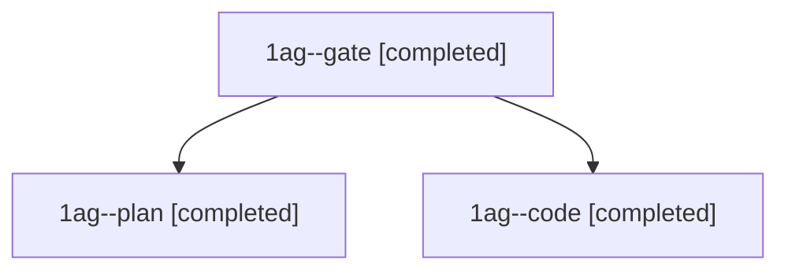

# Session: 1ag

[Agent Hoods](../README.md) / [bbugyi200](../users/bbugyi200/README.md) / [athena](../users/bbugyi200/machines/athena/README.md) / [1ag](../users/bbugyi200/machines/athena/hoods/1ag/README.md) / 1ag

Owner: `bbugyi200.athena` · Hood: `1ag` · Members: 3

## Lineage

The diagram is an optional enhancement; the ordered table below contains the same lineage in accessible text.

| Role | Agent | State | Model / provider | Timing | Commits | Prompt | Chat |
|---|---|---|---|---|---:|---|---|
| gate | 1ag--gate | completed | opus / claude | 2026-11-09T15:38:07.249330+00:00 → 2026-11-09T15:39:00.959546+00:00 | 0 | — | [Chat](../agents/bbugyi200.athena.1ag--gate/chat.md) |
| plan | 1ag--plan | completed | opus / claude | 2026-11-09T15:20:10.504481+00:00 → 2026-11-09T15:28:01.297261+00:00 | 0 | [Prompt](../agents/bbugyi200.athena.1ag--plan/prompt.md) | [Chat](../agents/bbugyi200.athena.1ag--plan/chat.md) |
| code | 1ag--code | completed | sonnet / claude | 2026-11-09T15:40:15.026314+00:00 → 2026-11-09T15:41:55.082379+00:00 | [1](../agents/bbugyi200.athena.1ag--code/README.md#commits) | [Prompt](../agents/bbugyi200.athena.1ag--code/prompt.md) | [Chat](../agents/bbugyi200.athena.1ag--code/chat.md) |

## Commits

| Role | Repo | Commit | Subject | Committed |
|---|---|---|---|---|
| code | bob-cli | [`f231b9d`](https://github.com/bobs-org/bob-cli/commit/f231b9d37fec4803c4470eeef65e5b5d27718076) | feat(memory): add Capture Alias glossary term | 2026-11-09 10:41:39 EST |
