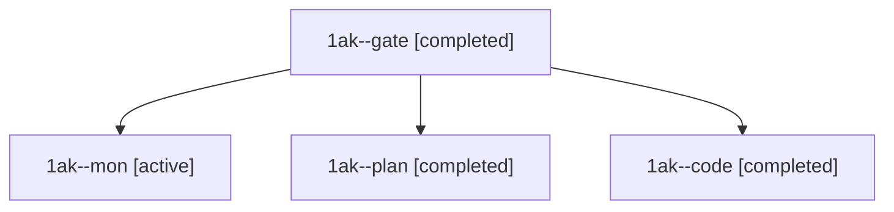

# Session: 1ak

[Agent Hoods](../README.md) / [bbugyi200](../users/bbugyi200/README.md) / [athena](../users/bbugyi200/machines/athena/README.md) / [1ak](../users/bbugyi200/machines/athena/hoods/1ak/README.md) / 1ak

Owner: `bbugyi200.athena` · Hood: `1ak` · Members: 4

## Lineage

The diagram is an optional enhancement; the ordered table below contains the same lineage in accessible text.

| Role | Agent | State | Model / provider | Timing | Commits | Prompt | Chat |
|---|---|---|---|---|---:|---|---|
| gate | 1ak--gate | completed | opus / claude | 2026-11-09T16:54:57.042048+00:00 → 2026-11-09T16:56:10.470867+00:00 | 0 | — | [Chat](../agents/bbugyi200.athena.1ak--gate/chat.md) |
| mon | 1ak--mon | active | grok-4.6 / grok | 2026-11-09T17:00:02.275266+00:00 | 0 | — | — |
| plan | 1ak--plan | completed | opus / claude | 2026-11-09T16:45:52.578551+00:00 → 2026-11-09T16:52:36.941867+00:00 | 0 | [Prompt](../agents/bbugyi200.athena.1ak--plan/prompt.md) | [Chat](../agents/bbugyi200.athena.1ak--plan/chat.md) |
| code | 1ak--code | completed | grok-4.6 / grok | 2026-11-09T16:57:13.589786+00:00 → 2026-11-09T17:01:37.319262+00:00 | [1](../agents/bbugyi200.athena.1ak--code/README.md#commits) | [Prompt](../agents/bbugyi200.athena.1ak--code/prompt.md) | [Chat](../agents/bbugyi200.athena.1ak--code/chat.md) |

## Commits

| Role | Repo | Commit | Subject | Committed |
|---|---|---|---|---|
| code | bob-cli | [`0d0851b`](https://github.com/bobs-org/bob-cli/commit/0d0851ba7c346eb221ff35e94f503fbff5fe3cdf) | docs(gmail): document the hourly Mac gmail sync slot | 2026-11-09 12:01:04 EST |
