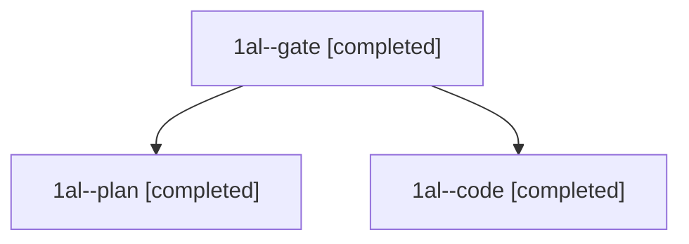

# Session: 1al

[Agent Hoods](../README.md) / [bbugyi200](../users/bbugyi200/README.md) / [athena](../users/bbugyi200/machines/athena/README.md) / [1al](../users/bbugyi200/machines/athena/hoods/1al/README.md) / 1al

Owner: `bbugyi200.athena` · Hood: `1al` · Members: 3

## Lineage

The diagram is an optional enhancement; the ordered table below contains the same lineage in accessible text.

| Role | Agent | State | Model / provider | Timing | Commits | Prompt | Chat |
|---|---|---|---|---|---:|---|---|
| gate | 1al--gate | completed | opus / claude | 2026-11-09T19:22:50.621723+00:00 → 2026-11-09T19:23:35.883070+00:00 | 0 | — | [Chat](../agents/bbugyi200.athena.1al--gate/chat.md) |
| plan | 1al--plan | completed | opus / claude | 2026-11-09T19:03:36.283777+00:00 → 2026-11-09T19:15:11.896846+00:00 | 0 | [Prompt](../agents/bbugyi200.athena.1al--plan/prompt.md) | [Chat](../agents/bbugyi200.athena.1al--plan/chat.md) |
| code | 1al--code | completed | muse-spark-1.3-contributor / muse | 2026-11-09T19:24:36.067070+00:00 → 2026-11-09T19:39:39.285024+00:00 | [1](../agents/bbugyi200.athena.1al--code/README.md#commits) | [Prompt](../agents/bbugyi200.athena.1al--code/prompt.md) | [Chat](../agents/bbugyi200.athena.1al--code/chat.md) |

## Commits

| Role | Repo | Commit | Subject | Committed |
|---|---|---|---|---|
| code | bob-cli | [`93d67df`](https://github.com/bobs-org/bob-cli/commit/93d67df48b53864b5ea43de90b71feec3386c72f) | fix(install): start failure excerpts at the first real compiler error | 2026-11-09 14:39:29 EST |
