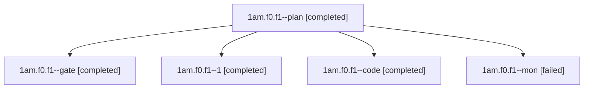

# Session: 1am.f0.f1

[Agent Hoods](../README.md) / [bbugyi200](../users/bbugyi200/README.md) / [athena](../users/bbugyi200/machines/athena/README.md) / [1am](../users/bbugyi200/machines/athena/hoods/1am/README.md) / 1am.f0.f1

Owner: `bbugyi200.athena` · Hood: `1am` · Members: 5

## Lineage

The diagram is an optional enhancement; the ordered table below contains the same lineage in accessible text.

| Role | Agent | State | Model / provider | Timing | Commits | Prompt | Chat |
|---|---|---|---|---|---:|---|---|
| plan | 1am.f0.f1--plan | completed | opus / claude | 2026-11-10T13:57:49.538505+00:00 → 2026-11-10T14:11:15.771864+00:00 | 0 | [Prompt](../agents/bbugyi200.athena.1am.f0.f1--plan/prompt.md) | [Chat](../agents/bbugyi200.athena.1am.f0.f1--plan/chat.md) |
| gate | 1am.f0.f1--gate | completed | opus / claude | 2026-11-10T14:12:20.669123+00:00 → 2026-11-10T14:13:10.501710+00:00 | 0 | — | [Chat](../agents/bbugyi200.athena.1am.f0.f1--gate/chat.md) |
| 1 | 1am.f0.f1--1 | completed | muse-spark-1.3-contributor / muse | 2026-11-10T14:44:41.523526+00:00 → 2026-11-10T14:55:14.829364+00:00 | [1](../agents/bbugyi200.athena.1am.f0.f1--1/README.md#commits) | [Prompt](../agents/bbugyi200.athena.1am.f0.f1--1/prompt.md) | [Chat](../agents/bbugyi200.athena.1am.f0.f1--1/chat.md) |
| code | 1am.f0.f1--code | completed | muse-spark-1.3-contributor / muse | 2026-11-10T14:13:47.679774+00:00 → 2026-11-10T14:37:07.426947+00:00 | 0 | [Prompt](../agents/bbugyi200.athena.1am.f0.f1--code/prompt.md) | [Chat](../agents/bbugyi200.athena.1am.f0.f1--code/chat.md) |
| mon | 1am.f0.f1--mon | failed | muse-spark-1.3-contributor / muse | 2026-11-10T14:35:46.044636+00:00 → 2026-11-10T14:43:53.336857+00:00 | 0 | — | [Chat](../agents/bbugyi200.athena.1am.f0.f1--mon/chat.md) |

## Commits

| Role | Repo | Commit | Subject | Committed |
|---|---|---|---|---|
| 1 | bob-cli | [`923b12e`](https://github.com/bobs-org/bob-cli/commit/923b12ea9feef53d743498b9c9fc08901291b07f) | feat(capture)!: switch dot suffix after route+id to caret marker | 2026-11-10 09:54:47 EST |

## Neighbors

| Agent | Relation | State |
|---|---|---|
| [1am.f0](bbugyi200.athena.1am.f0.md) (session · 7) | ancestor | completed 6, failed 1 |
| [1am](bbugyi200.athena.1am.md) (session · 5) | ancestor | completed 4, failed 1 |
| [1am.f0.f0](../agents/bbugyi200.athena.1am.f0.f0/README.md) | 1am.f0 hood | active |
