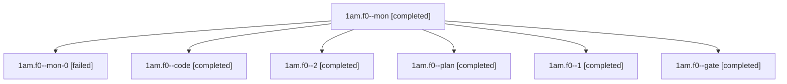

# Session: 1am.f0

[Agent Hoods](../README.md) / [bbugyi200](../users/bbugyi200/README.md) / [athena](../users/bbugyi200/machines/athena/README.md) / [1am](../users/bbugyi200/machines/athena/hoods/1am/README.md) / 1am.f0

Owner: `bbugyi200.athena` · Hood: `1am` · Members: 7

## Lineage

The diagram is an optional enhancement; the ordered table below contains the same lineage in accessible text.

| Role | Agent | State | Model / provider | Timing | Commits | Prompt | Chat |
|---|---|---|---|---|---:|---|---|
| mon | 1am.f0--mon | completed | gpt-6-luna / codex | 2026-11-10T12:36:09.206066+00:00 → 2026-11-10T12:45:47.325942+00:00 | 0 | — | [Chat](../agents/bbugyi200.athena.1am.f0--mon/chat.md) |
| mon-0 | 1am.f0--mon-0 | failed | gpt-6-luna / codex | 2026-11-10T12:47:13.119687+00:00 → 2026-11-10T12:54:03.928087+00:00 | 0 | — | [Chat](../agents/bbugyi200.athena.1am.f0--mon-0/chat.md) |
| code | 1am.f0--code | completed | gpt-6-luna / codex | 2026-11-10T12:17:44.913439+00:00 → 2026-11-10T12:37:12.517515+00:00 | 0 | [Prompt](../agents/bbugyi200.athena.1am.f0--code/prompt.md) | [Chat](../agents/bbugyi200.athena.1am.f0--code/chat.md) |
| 2 | 1am.f0--2 | completed | gpt-6-luna / codex | 2026-11-10T12:55:01.844761+00:00 → 2026-11-10T12:56:22.116913+00:00 | [1](../agents/bbugyi200.athena.1am.f0--2/README.md#commits) | [Prompt](../agents/bbugyi200.athena.1am.f0--2/prompt.md) | [Chat](../agents/bbugyi200.athena.1am.f0--2/chat.md) |
| plan | 1am.f0--plan | completed | opus / claude | 2026-11-10T11:22:31.938375+00:00 → 2026-11-10T11:35:13.342973+00:00 | 0 | [Prompt](../agents/bbugyi200.athena.1am.f0--plan/prompt.md) | [Chat](../agents/bbugyi200.athena.1am.f0--plan/chat.md) |
| 1 | 1am.f0--1 | completed | gpt-6-luna / codex | 2026-11-10T12:46:39.715265+00:00 → 2026-11-10T12:47:51.566590+00:00 | 0 | [Prompt](../agents/bbugyi200.athena.1am.f0--1/prompt.md) | [Chat](../agents/bbugyi200.athena.1am.f0--1/chat.md) |
| gate | 1am.f0--gate | completed | opus / claude | 2026-11-10T12:16:25.459246+00:00 → 2026-11-10T12:17:03.297299+00:00 | 0 | — | [Chat](../agents/bbugyi200.athena.1am.f0--gate/chat.md) |

## Commits

| Role | Repo | Commit | Subject | Committed |
|---|---|---|---|---|
| 2 | bob-cli | [`1f912b8`](https://github.com/bobs-org/bob-cli/commit/1f912b8cad58642e291b03f8938cae82d3c8abeb) | feat(capture): add comma alias separator switch | 2026-11-10 07:55:55 EST |

## Neighbors

| Agent | Relation | State |
|---|---|---|
| [1am](bbugyi200.athena.1am.md) (session · 5) | ancestor | completed 4, failed 1 |
| [1am.f0.f0](../agents/bbugyi200.athena.1am.f0.f0/README.md) | descendant | active |
| [1am.f0.f1](bbugyi200.athena.1am.f0.f1.md) (session · 5) | descendant | completed 4, failed 1 |
