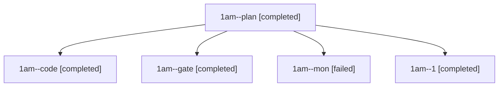

# Session: 1am

[Agent Hoods](../README.md) / [bbugyi200](../users/bbugyi200/README.md) / [athena](../users/bbugyi200/machines/athena/README.md) / [1am](../users/bbugyi200/machines/athena/hoods/1am/README.md) / 1am

Owner: `bbugyi200.athena` · Hood: `1am` · Members: 5

## Lineage

The diagram is an optional enhancement; the ordered table below contains the same lineage in accessible text.

| Role | Agent | State | Model / provider | Timing | Commits | Prompt | Chat |
|---|---|---|---|---|---:|---|---|
| plan | 1am--plan | completed | opus / claude | 2026-11-09T22:35:02.988046+00:00 → 2026-11-09T22:45:29.680223+00:00 | 0 | [Prompt](../agents/bbugyi200.athena.1am--plan/prompt.md) | [Chat](../agents/bbugyi200.athena.1am--plan/chat.md) |
| code | 1am--code | completed | gpt-6-luna / codex | 2026-11-09T22:52:48.231106+00:00 → 2026-11-09T23:55:15.805420+00:00 | 0 | [Prompt](../agents/bbugyi200.athena.1am--code/prompt.md) | [Chat](../agents/bbugyi200.athena.1am--code/chat.md) |
| gate | 1am--gate | completed | opus / claude | 2026-11-09T22:50:51.564820+00:00 → 2026-11-09T22:51:50.182047+00:00 | 0 | — | [Chat](../agents/bbugyi200.athena.1am--gate/chat.md) |
| mon | 1am--mon | failed | gpt-6-luna / codex | 2026-11-09T23:51:47.833556+00:00 → 2026-11-10T00:00:45.949352+00:00 | 0 | — | [Chat](../agents/bbugyi200.athena.1am--mon/chat.md) |
| 1 | 1am--1 | completed | gpt-6-luna / codex | 2026-11-10T00:02:04.245634+00:00 → 2026-11-10T00:06:06.263752+00:00 | [1](../agents/bbugyi200.athena.1am--1/README.md#commits) | [Prompt](../agents/bbugyi200.athena.1am--1/prompt.md) | [Chat](../agents/bbugyi200.athena.1am--1/chat.md) |

## Commits

| Role | Repo | Commit | Subject | Committed |
|---|---|---|---|---|
| 1 | bob-cli | [`8728fe2`](https://github.com/bobs-org/bob-cli/commit/8728fe2821821b078b95bf95dace78717721cb79) | feat(capture): toggle block ID separators with glued dot | 2026-11-09 19:05:37 EST |

## Neighbors

| Agent | Relation | State |
|---|---|---|
| [1am.f0](bbugyi200.athena.1am.f0.md) (session · 7) | descendant | completed 6, failed 1 |
