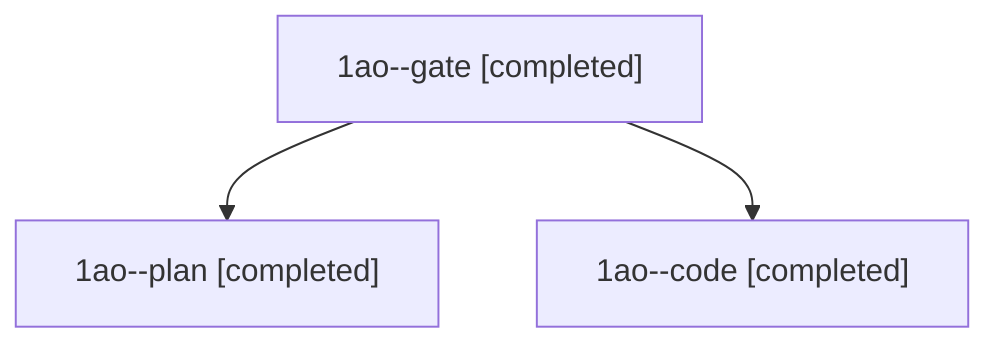

# Session: 1ao

[Agent Hoods](../README.md) / [bbugyi200](../users/bbugyi200/README.md) / [athena](../users/bbugyi200/machines/athena/README.md) / [1ao](../users/bbugyi200/machines/athena/hoods/1ao/README.md) / 1ao

Owner: `bbugyi200.athena` · Hood: `1ao` · Members: 3

## Lineage

The diagram is an optional enhancement; the ordered table below contains the same lineage in accessible text.

| Role | Agent | State | Model / provider | Timing | Commits | Prompt | Chat |
|---|---|---|---|---|---:|---|---|
| gate | 1ao--gate | completed | opus / claude | 2026-11-10T11:15:56.860134+00:00 → 2026-11-10T11:16:32.724980+00:00 | 0 | — | [Chat](../agents/bbugyi200.athena.1ao--gate/chat.md) |
| plan | 1ao--plan | completed | opus / claude | 2026-11-09T23:06:51.016570+00:00 → 2026-11-09T23:15:18.615475+00:00 | 0 | [Prompt](../agents/bbugyi200.athena.1ao--plan/prompt.md) | [Chat](../agents/bbugyi200.athena.1ao--plan/chat.md) |
| code | 1ao--code | completed | grok-4.6 / grok | 2026-11-10T11:17:17.624774+00:00 → 2026-11-10T11:50:40.916613+00:00 | 0 | [Prompt](../agents/bbugyi200.athena.1ao--code/prompt.md) | [Chat](../agents/bbugyi200.athena.1ao--code/chat.md) |
