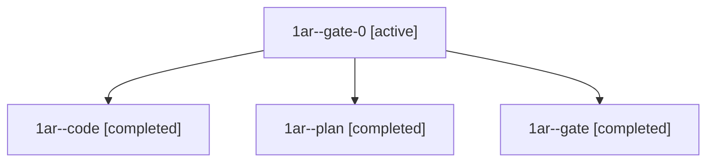

# Session: 1ar

[Agent Hoods](../README.md) / [bbugyi200](../users/bbugyi200/README.md) / [athena](../users/bbugyi200/machines/athena/README.md) / [1ar](../users/bbugyi200/machines/athena/hoods/1ar/README.md) / 1ar

Owner: `bbugyi200.athena` · Hood: `1ar` · Members: 4

## Lineage

The diagram is an optional enhancement; the ordered table below contains the same lineage in accessible text.

| Role | Agent | State | Model / provider | Timing | Commits | Prompt | Chat |
|---|---|---|---|---|---:|---|---|
| gate-0 | 1ar--gate-0 | active | grok-4.6 / grok | 2026-11-10T12:12:33.913848+00:00 | 0 | — | — |
| code | 1ar--code | completed | grok-4.6 / grok | 2026-11-10T12:02:08.681664+00:00 → 2026-11-10T12:12:36.072747+00:00 | 0 | [Prompt](../agents/bbugyi200.athena.1ar--code/prompt.md) | [Chat](../agents/bbugyi200.athena.1ar--code/chat.md) |
| plan | 1ar--plan | completed | opus / claude | 2026-11-10T11:51:07.505697+00:00 → 2026-11-10T11:59:50.412185+00:00 | 0 | [Prompt](../agents/bbugyi200.athena.1ar--plan/prompt.md) | [Chat](../agents/bbugyi200.athena.1ar--plan/chat.md) |
| gate | 1ar--gate | completed | opus / claude | 2026-11-10T12:00:38.738348+00:00 → 2026-11-10T12:01:30.243181+00:00 | 0 | — | [Chat](../agents/bbugyi200.athena.1ar--gate/chat.md) |
