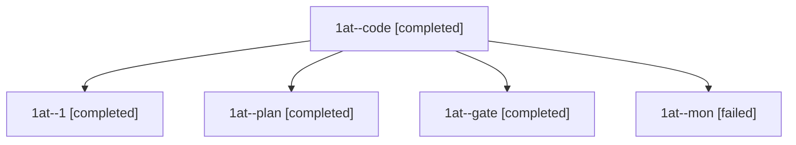

# Session: 1at

[Agent Hoods](../README.md) / [bbugyi200](../users/bbugyi200/README.md) / [athena](../users/bbugyi200/machines/athena/README.md) / [1at](../users/bbugyi200/machines/athena/hoods/1at/README.md) / 1at

Owner: `bbugyi200.athena` · Hood: `1at` · Members: 5

## Lineage

The diagram is an optional enhancement; the ordered table below contains the same lineage in accessible text.

| Role | Agent | State | Model / provider | Timing | Commits | Prompt | Chat |
|---|---|---|---|---|---:|---|---|
| code | 1at--code | completed | gpt-6-luna / codex | 2026-11-10T12:40:57.611464+00:00 → 2026-11-10T13:13:35.207235+00:00 | 0 | [Prompt](../agents/bbugyi200.athena.1at--code/prompt.md) | [Chat](../agents/bbugyi200.athena.1at--code/chat.md) |
| 1 | 1at--1 | completed | gpt-6-luna / codex | 2026-11-10T13:25:12.180845+00:00 → 2026-11-10T13:41:12.194323+00:00 | 0 | [Prompt](../agents/bbugyi200.athena.1at--1/prompt.md) | [Chat](../agents/bbugyi200.athena.1at--1/chat.md) |
| plan | 1at--plan | completed | opus / claude | 2026-11-10T12:27:23.870448+00:00 → 2026-11-10T12:38:39.326356+00:00 | 0 | [Prompt](../agents/bbugyi200.athena.1at--plan/prompt.md) | [Chat](../agents/bbugyi200.athena.1at--plan/chat.md) |
| gate | 1at--gate | completed | opus / claude | 2026-11-10T12:39:32.602935+00:00 → 2026-11-10T12:40:12.584206+00:00 | 0 | — | [Chat](../agents/bbugyi200.athena.1at--gate/chat.md) |
| mon | 1at--mon | failed | gpt-6-luna / codex | 2026-11-10T13:12:34.172633+00:00 → 2026-11-10T13:24:07.218676+00:00 | 0 | — | [Chat](../agents/bbugyi200.athena.1at--mon/chat.md) |
