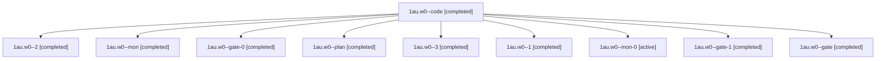

# Session: 1au.w0

[Agent Hoods](../README.md) / [bbugyi200](../users/bbugyi200/README.md) / [athena](../users/bbugyi200/machines/athena/README.md) / [1au](../users/bbugyi200/machines/athena/hoods/1au/README.md) / 1au.w0

Owner: `bbugyi200.athena` · Hood: `1au` · Members: 10

## Lineage

The diagram is an optional enhancement; the ordered table below contains the same lineage in accessible text.

| Role | Agent | State | Model / provider | Timing | Commits | Prompt | Chat |
|---|---|---|---|---|---:|---|---|
| code | 1au.w0--code | completed | grok-4.6 / grok | 2026-11-10T14:00:49.106325+00:00 → 2026-11-10T14:03:47.446142+00:00 | 0 | [Prompt](../agents/bbugyi200.athena.1au.w0--code/prompt.md) | [Chat](../agents/bbugyi200.athena.1au.w0--code/chat.md) |
| 2 | 1au.w0--2 | completed | grok-4.6 / grok | 2026-11-10T14:25:05.970102+00:00 → 2026-11-10T14:27:29.740844+00:00 | 0 | [Prompt](../agents/bbugyi200.athena.1au.w0--2/prompt.md) | [Chat](../agents/bbugyi200.athena.1au.w0--2/chat.md) |
| mon | 1au.w0--mon | completed | grok-4.6 / grok | 2026-11-10T14:11:39.148434+00:00 → 2026-11-10T14:24:09.627907+00:00 | 0 | — | [Chat](../agents/bbugyi200.athena.1au.w0--mon/chat.md) |
| gate-0 | 1au.w0--gate-0 | completed | grok-4.6 / grok | 2026-11-10T14:05:20.842475+00:00 → 2026-11-10T14:06:06.088779+00:00 | 0 | — | [Chat](../agents/bbugyi200.athena.1au.w0--gate-0/chat.md) |
| plan | 1au.w0--plan | completed | opus / claude | 2026-11-10T13:47:18.108946+00:00 → 2026-11-10T13:57:41.312400+00:00 | 0 | [Prompt](../agents/bbugyi200.athena.1au.w0--plan/prompt.md) | [Chat](../agents/bbugyi200.athena.1au.w0--plan/chat.md) |
| 3 | 1au.w0--3 | completed | grok-4.6 / grok | 2026-11-10T14:30:05.179782+00:00 → 2026-11-10T14:42:13.380531+00:00 | 0 | [Prompt](../agents/bbugyi200.athena.1au.w0--3/prompt.md) | [Chat](../agents/bbugyi200.athena.1au.w0--3/chat.md) |
| 1 | 1au.w0--1 | completed | grok-4.6 / grok | 2026-11-10T14:07:41.853048+00:00 → 2026-11-10T14:12:10.413641+00:00 | 0 | [Prompt](../agents/bbugyi200.athena.1au.w0--1/prompt.md) | [Chat](../agents/bbugyi200.athena.1au.w0--1/chat.md) |
| mon-0 | 1au.w0--mon-0 | active | grok-4.6 / grok | 2026-11-10T14:40:57.876128+00:00 | 0 | — | — |
| gate-1 | 1au.w0--gate-1 | completed | grok-4.6 / grok | 2026-11-10T14:27:26.665201+00:00 → 2026-11-10T14:28:27.156724+00:00 | 0 | — | [Chat](../agents/bbugyi200.athena.1au.w0--gate-1/chat.md) |
| gate | 1au.w0--gate | completed | opus / claude | 2026-11-10T13:59:30.258267+00:00 → 2026-11-10T14:00:10.003636+00:00 | 0 | — | [Chat](../agents/bbugyi200.athena.1au.w0--gate/chat.md) |
