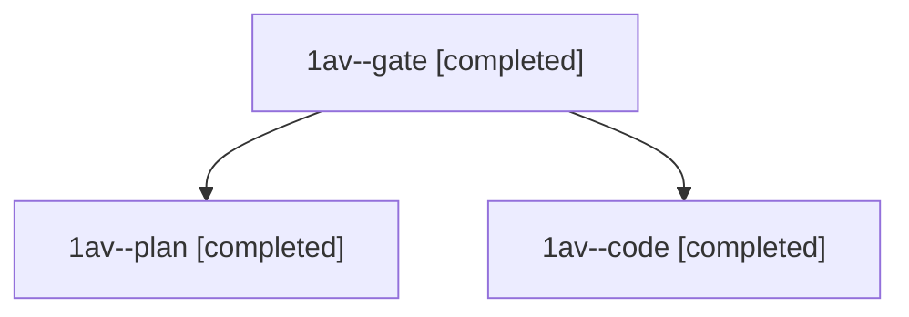

# Session: 1av

[Agent Hoods](../README.md) / [bbugyi200](../users/bbugyi200/README.md) / [athena](../users/bbugyi200/machines/athena/README.md) / [1av](../users/bbugyi200/machines/athena/hoods/1av/README.md) / 1av

Owner: `bbugyi200.athena` · Hood: `1av` · Members: 3

## Lineage

The diagram is an optional enhancement; the ordered table below contains the same lineage in accessible text.

| Role | Agent | State | Model / provider | Timing | Commits | Prompt | Chat |
|---|---|---|---|---|---:|---|---|
| gate | 1av--gate | completed | opus / claude | 2026-11-10T13:09:20.586126+00:00 → 2026-11-10T13:09:58.122580+00:00 | 0 | — | [Chat](../agents/bbugyi200.athena.1av--gate/chat.md) |
| plan | 1av--plan | completed | opus / claude | 2026-11-10T12:55:56.753264+00:00 → 2026-11-10T13:04:31.538005+00:00 | 0 | [Prompt](../agents/bbugyi200.athena.1av--plan/prompt.md) | [Chat](../agents/bbugyi200.athena.1av--plan/chat.md) |
| code | 1av--code | completed | muse-spark-1.3-contributor / muse | 2026-11-10T13:10:39.010123+00:00 → 2026-11-10T13:38:17.788285+00:00 | [1](../agents/bbugyi200.athena.1av--code/README.md#commits) | [Prompt](../agents/bbugyi200.athena.1av--code/prompt.md) | [Chat](../agents/bbugyi200.athena.1av--code/chat.md) |

## Commits

| Role | Repo | Commit | Subject | Committed |
|---|---|---|---|---|
| code | bob-cli | [`8a12767`](https://github.com/bobs-org/bob-cli/commit/8a12767fc559f81bf43897839e51f876af62dd71) | feat(capture): prefer dependency alias once item is routed | 2026-11-10 08:37:51 EST |
