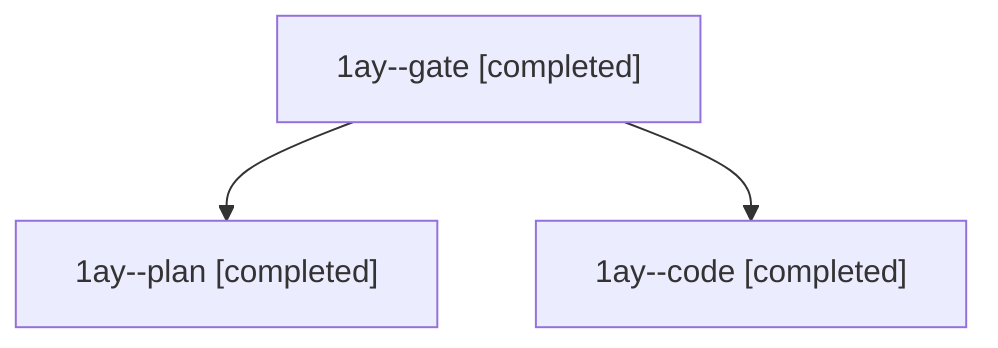

# Session: 1ay

[Agent Hoods](../README.md) / [bbugyi200](../users/bbugyi200/README.md) / [athena](../users/bbugyi200/machines/athena/README.md) / [1ay](../users/bbugyi200/machines/athena/hoods/1ay/README.md) / 1ay

Owner: `bbugyi200.athena` · Hood: `1ay` · Members: 3

## Lineage

The diagram is an optional enhancement; the ordered table below contains the same lineage in accessible text.

| Role | Agent | State | Model / provider | Timing | Commits | Prompt | Chat |
|---|---|---|---|---|---:|---|---|
| gate | 1ay--gate | completed | opus / claude | 2026-11-10T15:02:04.874822+00:00 → 2026-11-10T15:02:58.436281+00:00 | 0 | — | [Chat](../agents/bbugyi200.athena.1ay--gate/chat.md) |
| plan | 1ay--plan | completed | opus / claude | 2026-11-10T14:38:35.985845+00:00 → 2026-11-10T14:50:18.734159+00:00 | 0 | [Prompt](../agents/bbugyi200.athena.1ay--plan/prompt.md) | [Chat](../agents/bbugyi200.athena.1ay--plan/chat.md) |
| code | 1ay--code | completed | muse-spark-1.3-contributor / muse | 2026-11-10T15:03:34.707166+00:00 → 2026-11-10T15:17:21.617107+00:00 | [1](../agents/bbugyi200.athena.1ay--code/README.md#commits) | [Prompt](../agents/bbugyi200.athena.1ay--code/prompt.md) | [Chat](../agents/bbugyi200.athena.1ay--code/chat.md) |

## Commits

| Role | Repo | Commit | Subject | Committed |
|---|---|---|---|---|
| code | bob-cli | [`9bd9d21`](https://github.com/bobs-org/bob-cli/commit/9bd9d21e3f1efa163bf48db8df43332d8c3fccee) | feat(freshness): show TICK Alt+P answer as tier-tinted chip in footer docs and glossary | 2026-11-10 10:16:59 EST |
