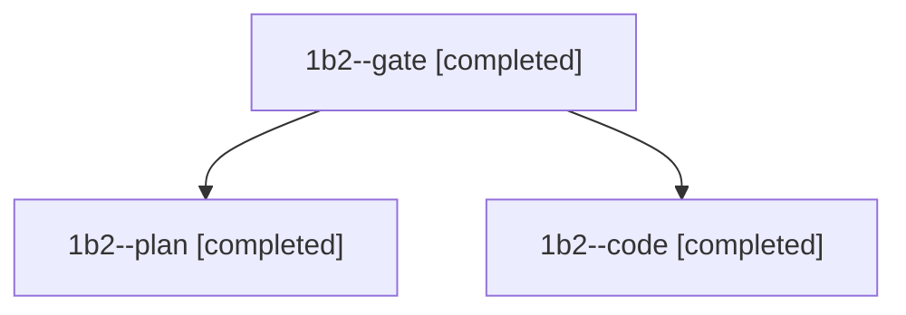

# Session: 1b2

[Agent Hoods](../README.md) / [bbugyi200](../users/bbugyi200/README.md) / [athena](../users/bbugyi200/machines/athena/README.md) / [1b2](../users/bbugyi200/machines/athena/hoods/1b2/README.md) / 1b2

Owner: `bbugyi200.athena` · Hood: `1b2` · Members: 3

## Lineage

The diagram is an optional enhancement; the ordered table below contains the same lineage in accessible text.

| Role | Agent | State | Model / provider | Timing | Commits | Prompt | Chat |
|---|---|---|---|---|---:|---|---|
| gate | 1b2--gate | completed | opus / claude | 2026-11-10T20:36:20.718301+00:00 → 2026-11-10T20:37:33.381911+00:00 | 0 | — | [Chat](../agents/bbugyi200.athena.1b2--gate/chat.md) |
| plan | 1b2--plan | completed | opus / claude | 2026-11-10T20:27:01.498202+00:00 → 2026-11-10T20:35:01.419500+00:00 | 0 | [Prompt](../agents/bbugyi200.athena.1b2--plan/prompt.md) | [Chat](../agents/bbugyi200.athena.1b2--plan/chat.md) |
| code | 1b2--code | completed | grok-4.6 / grok | 2026-11-10T20:38:28.374822+00:00 → 2026-11-10T20:55:48.313226+00:00 | 0 | [Prompt](../agents/bbugyi200.athena.1b2--code/prompt.md) | [Chat](../agents/bbugyi200.athena.1b2--code/chat.md) |
