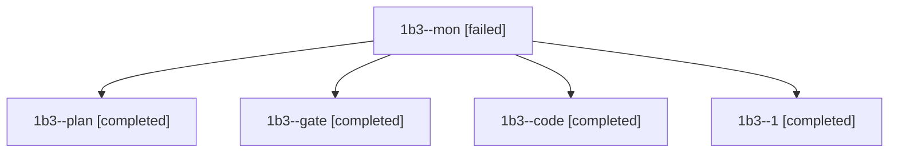

# Session: 1b3

[Agent Hoods](../README.md) / [bbugyi200](../users/bbugyi200/README.md) / [athena](../users/bbugyi200/machines/athena/README.md) / [1b3](../users/bbugyi200/machines/athena/hoods/1b3/README.md) / 1b3

Owner: `bbugyi200.athena` · Hood: `1b3` · Members: 5

## Lineage

The diagram is an optional enhancement; the ordered table below contains the same lineage in accessible text.

| Role | Agent | State | Model / provider | Timing | Commits | Prompt | Chat |
|---|---|---|---|---|---:|---|---|
| mon | 1b3--mon | failed | grok-4.6 / grok | 2026-11-11T11:34:45.459731+00:00 → 2026-11-11T11:56:28.296383+00:00 | 0 | — | [Chat](../agents/bbugyi200.athena.1b3--mon/chat.md) |
| plan | 1b3--plan | completed | opus / claude | 2026-11-11T10:29:20.794395+00:00 → 2026-11-11T10:40:24.284510+00:00 | 0 | [Prompt](../agents/bbugyi200.athena.1b3--plan/prompt.md) | [Chat](../agents/bbugyi200.athena.1b3--plan/chat.md) |
| gate | 1b3--gate | completed | opus / claude | 2026-11-11T10:46:07.187356+00:00 → 2026-11-11T10:46:59.731719+00:00 | 0 | — | [Chat](../agents/bbugyi200.athena.1b3--gate/chat.md) |
| code | 1b3--code | completed | grok-4.6 / grok | 2026-11-11T10:47:36.228255+00:00 → 2026-11-11T11:35:53.725165+00:00 | 0 | [Prompt](../agents/bbugyi200.athena.1b3--code/prompt.md) | [Chat](../agents/bbugyi200.athena.1b3--code/chat.md) |
| 1 | 1b3--1 | completed | grok-4.6 / grok | 2026-11-11T11:57:25.331114+00:00 → 2026-11-11T12:15:09.698739+00:00 | [1](../agents/bbugyi200.athena.1b3--1/README.md#commits) | [Prompt](../agents/bbugyi200.athena.1b3--1/prompt.md) | [Chat](../agents/bbugyi200.athena.1b3--1/chat.md) |

## Commits

| Role | Repo | Commit | Subject | Committed |
|---|---|---|---|---|
| 1 | bob-cli | [`01c8e82`](https://github.com/bobs-org/bob-cli/commit/01c8e822508fb34ce70dab4f4eaf375128b5cab7) | fix(capture): restore disjoint record parse spans | 2026-11-11 07:14:49 EST |
