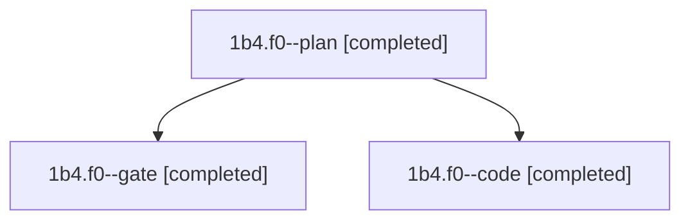

# Session: 1b4.f0

[Agent Hoods](../README.md) / [bbugyi200](../users/bbugyi200/README.md) / [athena](../users/bbugyi200/machines/athena/README.md) / [1b4](../users/bbugyi200/machines/athena/hoods/1b4/README.md) / 1b4.f0

Owner: `bbugyi200.athena` · Hood: `1b4` · Members: 3

## Lineage

The diagram is an optional enhancement; the ordered table below contains the same lineage in accessible text.

| Role | Agent | State | Model / provider | Timing | Commits | Prompt | Chat |
|---|---|---|---|---|---:|---|---|
| plan | 1b4.f0--plan | completed | opus / claude | 2026-11-11T10:38:38.966974+00:00 → 2026-11-11T11:01:53.849321+00:00 | 0 | [Prompt](../agents/bbugyi200.athena.1b4.f0--plan/prompt.md) | [Chat](../agents/bbugyi200.athena.1b4.f0--plan/chat.md) |
| gate | 1b4.f0--gate | completed | opus / claude | 2026-11-11T11:02:29.954522+00:00 → 2026-11-11T11:03:23.594636+00:00 | 0 | — | [Chat](../agents/bbugyi200.athena.1b4.f0--gate/chat.md) |
| code | 1b4.f0--code | completed | muse-spark-1.3-contributor / muse | 2026-11-11T11:04:15.541878+00:00 → 2026-11-11T11:14:31.298769+00:00 | 0 | [Prompt](../agents/bbugyi200.athena.1b4.f0--code/prompt.md) | [Chat](../agents/bbugyi200.athena.1b4.f0--code/chat.md) |

## Neighbors

| Agent | Relation | State |
|---|---|---|
| [1b4](../agents/bbugyi200.athena.1b4/README.md) | ancestor | completed |
