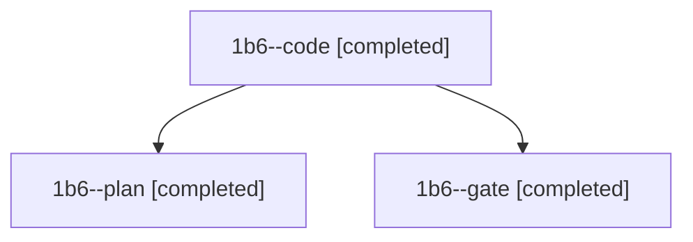

# Session: 1b6

[Agent Hoods](../README.md) / [bbugyi200](../users/bbugyi200/README.md) / [athena](../users/bbugyi200/machines/athena/README.md) / [1b6](../users/bbugyi200/machines/athena/hoods/1b6/README.md) / 1b6

Owner: `bbugyi200.athena` · Hood: `1b6` · Members: 3

## Lineage

The diagram is an optional enhancement; the ordered table below contains the same lineage in accessible text.

| Role | Agent | State | Model / provider | Timing | Commits | Prompt | Chat |
|---|---|---|---|---|---:|---|---|
| code | 1b6--code | completed | gpt-6-luna / codex | 2026-11-11T11:47:52.125636+00:00 → 2026-11-11T11:58:31.159858+00:00 | 0 | [Prompt](../agents/bbugyi200.athena.1b6--code/prompt.md) | [Chat](../agents/bbugyi200.athena.1b6--code/chat.md) |
| plan | 1b6--plan | completed | opus / claude | 2026-11-11T11:36:26.320617+00:00 → 2026-11-11T11:45:10.475113+00:00 | 0 | [Prompt](../agents/bbugyi200.athena.1b6--plan/prompt.md) | [Chat](../agents/bbugyi200.athena.1b6--plan/chat.md) |
| gate | 1b6--gate | completed | opus / claude | 2026-11-11T11:46:16.811616+00:00 → 2026-11-11T11:47:14.278378+00:00 | 0 | — | [Chat](../agents/bbugyi200.athena.1b6--gate/chat.md) |
