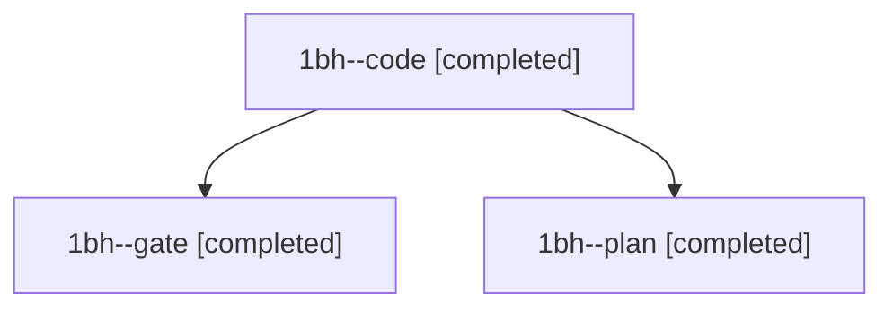

# Session: 1bh

[Agent Hoods](../README.md) / [bbugyi200](../users/bbugyi200/README.md) / [athena](../users/bbugyi200/machines/athena/README.md) / [1bh](../users/bbugyi200/machines/athena/hoods/1bh/README.md) / 1bh

Owner: `bbugyi200.athena` · Hood: `1bh` · Members: 3

## Lineage

The diagram is an optional enhancement; the ordered table below contains the same lineage in accessible text.

| Role | Agent | State | Model / provider | Timing | Commits | Prompt | Chat |
|---|---|---|---|---|---:|---|---|
| code | 1bh--code | completed | gpt-6-luna / codex | 2026-11-11T17:45:19.547510+00:00 → 2026-11-11T17:48:48.782911+00:00 | 0 | [Prompt](../agents/bbugyi200.athena.1bh--code/prompt.md) | [Chat](../agents/bbugyi200.athena.1bh--code/chat.md) |
| gate | 1bh--gate | completed | opus / claude | 2026-11-11T17:43:28.848872+00:00 → 2026-11-11T17:44:21.863668+00:00 | 0 | — | [Chat](../agents/bbugyi200.athena.1bh--gate/chat.md) |
| plan | 1bh--plan | completed | opus / claude | 2026-11-11T17:35:50.746027+00:00 → 2026-11-11T17:42:53.662392+00:00 | 0 | [Prompt](../agents/bbugyi200.athena.1bh--plan/prompt.md) | [Chat](../agents/bbugyi200.athena.1bh--plan/chat.md) |
