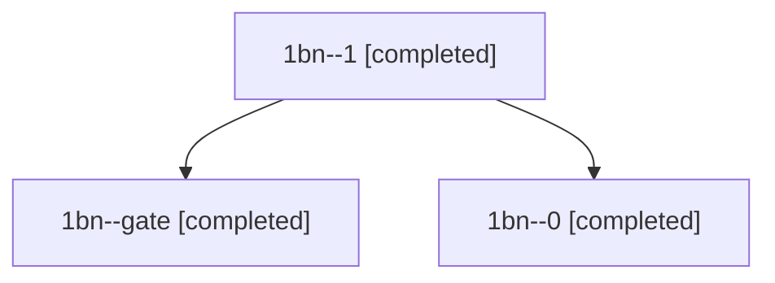

# Session: 1bn

[Agent Hoods](../README.md) / [bbugyi200](../users/bbugyi200/README.md) / [athena](../users/bbugyi200/machines/athena/README.md) / [1bn](../users/bbugyi200/machines/athena/hoods/1bn/README.md) / 1bn

Owner: `bbugyi200.athena` · Hood: `1bn` · Members: 3

## Lineage

The diagram is an optional enhancement; the ordered table below contains the same lineage in accessible text.

| Role | Agent | State | Model / provider | Timing | Commits | Prompt | Chat |
|---|---|---|---|---|---:|---|---|
| 1 | 1bn--1 | completed | gpt-6-astra / codex | 2026-11-11T22:18:10.805044+00:00 → 2026-11-11T22:23:08.788092+00:00 | [1](../agents/bbugyi200.athena.1bn--1/README.md#commits) | [Prompt](../agents/bbugyi200.athena.1bn--1/prompt.md) | [Chat](../agents/bbugyi200.athena.1bn--1/chat.md) |
| gate | 1bn--gate | completed | gpt-6-astra / codex | 2026-11-11T22:13:18.306201+00:00 → 2026-11-11T22:15:10.870440+00:00 | 0 | — | [Chat](../agents/bbugyi200.athena.1bn--gate/chat.md) |
| 0 | 1bn--0 | completed | gpt-6-astra / codex | 2026-11-11T21:16:10.873120+00:00 → 2026-11-11T21:45:25.739134+00:00 | 0 | [Prompt](../agents/bbugyi200.athena.1bn--0/prompt.md) | [Chat](../agents/bbugyi200.athena.1bn--0/chat.md) |

## Commits

| Role | Repo | Commit | Subject | Committed |
|---|---|---|---|---|
| 1 | bob-cli | [`bc3983d`](https://github.com/bobs-org/bob-cli/commit/bc3983d36413e70716d824992addb1d85099cdc1) | fix(keep-moving): restore the sub-project leaf rule | 2026-11-11 17:22:51 EST |
