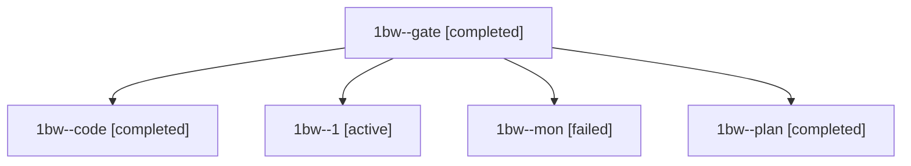

# Session: 1bw

[Agent Hoods](../README.md) / [bbugyi200](../users/bbugyi200/README.md) / [athena](../users/bbugyi200/machines/athena/README.md) / [1bw](../users/bbugyi200/machines/athena/hoods/1bw/README.md) / 1bw

Owner: `bbugyi200.athena` · Hood: `1bw` · Members: 5

## Lineage

The diagram is an optional enhancement; the ordered table below contains the same lineage in accessible text.

| Role | Agent | State | Model / provider | Timing | Commits | Prompt | Chat |
|---|---|---|---|---|---:|---|---|
| gate | 1bw--gate | completed | claude-fable-5 / claude | 2026-11-12T18:17:55.567409+00:00 → 2026-11-12T18:19:31.892117+00:00 | 0 | — | [Chat](../agents/bbugyi200.athena.1bw--gate/chat.md) |
| code | 1bw--code | completed | gpt-6-luna / codex | 2026-11-12T18:21:13.399752+00:00 → 2026-11-12T18:45:34.512744+00:00 | 0 | [Prompt](../agents/bbugyi200.athena.1bw--code/prompt.md) | [Chat](../agents/bbugyi200.athena.1bw--code/chat.md) |
| 1 | 1bw--1 | active | gpt-6-luna / codex | 2026-11-12T18:57:38.593702+00:00 | [1](../agents/bbugyi200.athena.1bw--1/README.md#commits) | [Prompt](../agents/bbugyi200.athena.1bw--1/prompt.md) | — |
| mon | 1bw--mon | failed | gpt-6-luna / codex | 2026-11-12T18:43:57.015079+00:00 → 2026-11-12T18:55:29.704051+00:00 | 0 | — | [Chat](../agents/bbugyi200.athena.1bw--mon/chat.md) |
| plan | 1bw--plan | completed | claude-fable-5 / claude | 2026-11-12T17:59:29.801576+00:00 → 2026-11-12T18:16:51.753349+00:00 | 0 | [Prompt](../agents/bbugyi200.athena.1bw--plan/prompt.md) | [Chat](../agents/bbugyi200.athena.1bw--plan/chat.md) |

## Commits

| Role | Repo | Commit | Subject | Committed |
|---|---|---|---|---|
| 1 | bob-cli | [`4f7ab37`](https://github.com/bobs-org/bob-cli/commit/4f7ab37f6180a84309e5f06e674a0f3afce5c135) | feat(gcal): include synced day in human output | 2026-11-12 14:50:58 EST |
