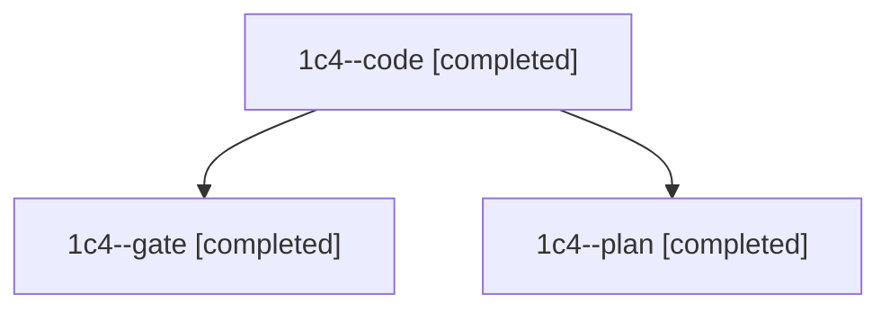

# Session: 1c4

[Agent Hoods](../README.md) / [bbugyi200](../users/bbugyi200/README.md) / [athena](../users/bbugyi200/machines/athena/README.md) / [1c4](../users/bbugyi200/machines/athena/hoods/1c4/README.md) / 1c4

Owner: `bbugyi200.athena` · Hood: `1c4` · Members: 3

## Lineage

The diagram is an optional enhancement; the ordered table below contains the same lineage in accessible text.

| Role | Agent | State | Model / provider | Timing | Commits | Prompt | Chat |
|---|---|---|---|---|---:|---|---|
| code | 1c4--code | completed | muse-spark-1.3-contributor / muse | 2026-11-13T10:50:09.293355+00:00 → 2026-11-13T11:48:55.667518+00:00 | [1](../agents/bbugyi200.athena.1c4--code/README.md#commits) | [Prompt](../agents/bbugyi200.athena.1c4--code/prompt.md) | [Chat](../agents/bbugyi200.athena.1c4--code/chat.md) |
| gate | 1c4--gate | completed | claude-fable-5 / claude | 2026-11-13T10:48:02.944387+00:00 → 2026-11-13T10:49:19.276621+00:00 | 0 | — | [Chat](../agents/bbugyi200.athena.1c4--gate/chat.md) |
| plan | 1c4--plan | completed | claude-fable-5 / claude | 2026-11-13T10:12:36.993569+00:00 → 2026-11-13T10:32:27.227955+00:00 | 0 | [Prompt](../agents/bbugyi200.athena.1c4--plan/prompt.md) | [Chat](../agents/bbugyi200.athena.1c4--plan/chat.md) |

## Commits

| Role | Repo | Commit | Subject | Committed |
|---|---|---|---|---|
| code | bob-cli | [`78c0e08`](https://github.com/bobs-org/bob-cli/commit/78c0e085acf2fdca06977a1ecf79fcc8465fcbb6) | feat(capture): advertise record\_field need on keyless first-level bullets | 2026-11-13 06:48:14 EST |
