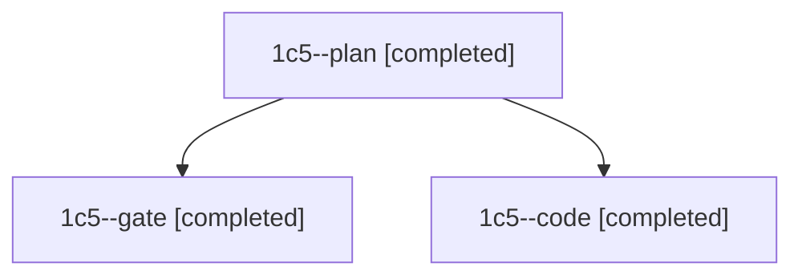

# Session: 1c5

[Agent Hoods](../README.md) / [bbugyi200](../users/bbugyi200/README.md) / [athena](../users/bbugyi200/machines/athena/README.md) / [1c5](../users/bbugyi200/machines/athena/hoods/1c5/README.md) / 1c5

Owner: `bbugyi200.athena` · Hood: `1c5` · Members: 3

## Lineage

The diagram is an optional enhancement; the ordered table below contains the same lineage in accessible text.

| Role | Agent | State | Model / provider | Timing | Commits | Prompt | Chat |
|---|---|---|---|---|---:|---|---|
| plan | 1c5--plan | completed | claude-fable-5 / claude | 2026-11-13T12:37:22.150792+00:00 → 2026-11-13T12:57:34.453523+00:00 | 0 | [Prompt](../agents/bbugyi200.athena.1c5--plan/prompt.md) | [Chat](../agents/bbugyi200.athena.1c5--plan/chat.md) |
| gate | 1c5--gate | completed | claude-fable-5 / claude | 2026-11-13T12:58:36.047115+00:00 → 2026-11-13T12:59:31.864242+00:00 | 0 | — | [Chat](../agents/bbugyi200.athena.1c5--gate/chat.md) |
| code | 1c5--code | completed | muse-spark-1.3-contributor / muse | 2026-11-13T13:00:04.786351+00:00 → 2026-11-13T13:31:09.015048+00:00 | [1](../agents/bbugyi200.athena.1c5--code/README.md#commits) | [Prompt](../agents/bbugyi200.athena.1c5--code/prompt.md) | [Chat](../agents/bbugyi200.athena.1c5--code/chat.md) |

## Commits

| Role | Repo | Commit | Subject | Committed |
|---|---|---|---|---|
| code | bob-cli | [`c9cf2dd`](https://github.com/bobs-org/bob-cli/commit/c9cf2dd443e347bb3f2d39c4f9906b4146b3e617) | feat(gmail): describe Task Link Gmail hop and warn on disabled sync deploys | 2026-11-13 08:30:28 EST |

## Neighbors

| Agent | Relation | State |
|---|---|---|
| [1c5.w0](../agents/bbugyi200.athena.1c5.w0/README.md) | descendant | active |
