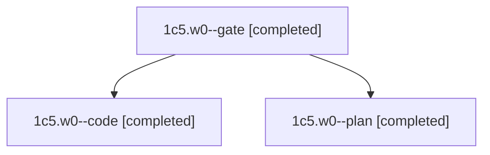

# Session: 1c5.w0

[Agent Hoods](../README.md) / [bbugyi200](../users/bbugyi200/README.md) / [athena](../users/bbugyi200/machines/athena/README.md) / [1c5](../users/bbugyi200/machines/athena/hoods/1c5/README.md) / 1c5.w0

Owner: `bbugyi200.athena` · Hood: `1c5` · Members: 3

## Lineage

The diagram is an optional enhancement; the ordered table below contains the same lineage in accessible text.

| Role | Agent | State | Model / provider | Timing | Commits | Prompt | Chat |
|---|---|---|---|---|---:|---|---|
| gate | 1c5.w0--gate | completed | opus / claude | 2026-11-13T13:51:03.687598+00:00 → 2026-11-13T13:51:41.344316+00:00 | 0 | — | [Chat](../agents/bbugyi200.athena.1c5.w0--gate/chat.md) |
| code | 1c5.w0--code | completed | muse-spark-1.3-contributor / muse | 2026-11-13T13:52:11.176649+00:00 → 2026-11-13T14:51:01.452267+00:00 | [1](../agents/bbugyi200.athena.1c5.w0--code/README.md#commits) | [Prompt](../agents/bbugyi200.athena.1c5.w0--code/prompt.md) | [Chat](../agents/bbugyi200.athena.1c5.w0--code/chat.md) |
| plan | 1c5.w0--plan | completed | opus / claude | 2026-11-13T13:31:17.431753+00:00 → 2026-11-13T13:41:06.193150+00:00 | 0 | [Prompt](../agents/bbugyi200.athena.1c5.w0--plan/prompt.md) | [Chat](../agents/bbugyi200.athena.1c5.w0--plan/chat.md) |

## Commits

| Role | Repo | Commit | Subject | Committed |
|---|---|---|---|---|
| code | bob-cli | [`ced8a5c`](https://github.com/bobs-org/bob-cli/commit/ced8a5c26f6bbe8f92a2cc915271c288c05dbcdc) | feat(plugins)!: require plugins.sync allowlist for bob plugins sync | 2026-11-13 09:49:57 EST |

## Neighbors

| Agent | Relation | State |
|---|---|---|
| [1c5](bbugyi200.athena.1c5.md) (session · 3) | ancestor | completed 3 |
