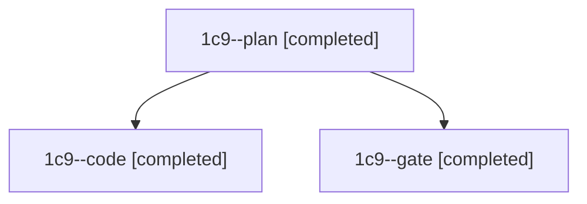

# Session: 1c9

[Agent Hoods](../README.md) / [bbugyi200](../users/bbugyi200/README.md) / [athena](../users/bbugyi200/machines/athena/README.md) / [1c9](../users/bbugyi200/machines/athena/hoods/1c9/README.md) / 1c9

Owner: `bbugyi200.athena` · Hood: `1c9` · Members: 3

## Lineage

The diagram is an optional enhancement; the ordered table below contains the same lineage in accessible text.

| Role | Agent | State | Model / provider | Timing | Commits | Prompt | Chat |
|---|---|---|---|---|---:|---|---|
| plan | 1c9--plan | completed | opus / claude | 2026-11-13T22:33:22.206890+00:00 → 2026-11-13T22:40:04.828657+00:00 | 0 | [Prompt](../agents/bbugyi200.athena.1c9--plan/prompt.md) | [Chat](../agents/bbugyi200.athena.1c9--plan/chat.md) |
| code | 1c9--code | completed | gpt-6-luna / codex | 2026-11-13T22:42:16.347919+00:00 → 2026-11-13T22:51:07.981250+00:00 | [1](../agents/bbugyi200.athena.1c9--code/README.md#commits) | [Prompt](../agents/bbugyi200.athena.1c9--code/prompt.md) | [Chat](../agents/bbugyi200.athena.1c9--code/chat.md) |
| gate | 1c9--gate | completed | opus / claude | 2026-11-13T22:40:31.514513+00:00 → 2026-11-13T22:41:42.115307+00:00 | 0 | — | [Chat](../agents/bbugyi200.athena.1c9--gate/chat.md) |

## Commits

| Role | Repo | Commit | Subject | Committed |
|---|---|---|---|---|
| code | bob-cli | [`5b1b6d5`](https://github.com/bobs-org/bob-cli/commit/5b1b6d596338b2358f528759d67d36a71ee303a4) | fix(notify): remove dead PATH helper | 2026-11-13 17:50:47 EST |
