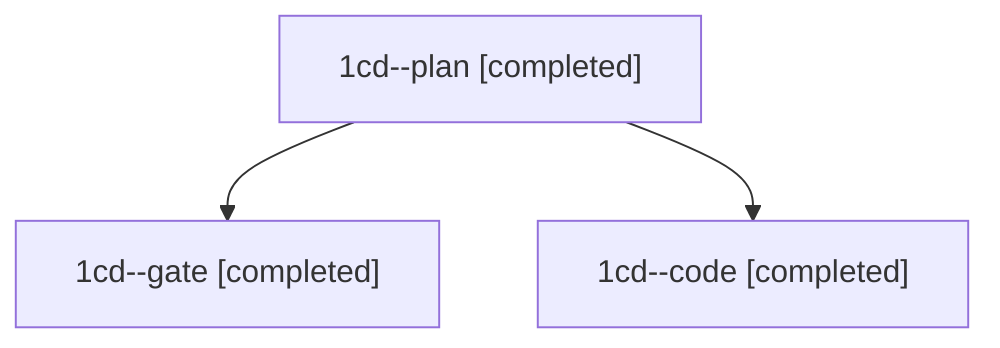

# Session: 1cd

[Agent Hoods](../README.md) / [bbugyi200](../users/bbugyi200/README.md) / [athena](../users/bbugyi200/machines/athena/README.md) / [1cd](../users/bbugyi200/machines/athena/hoods/1cd/README.md) / 1cd

Owner: `bbugyi200.athena` · Hood: `1cd` · Members: 3

## Lineage

The diagram is an optional enhancement; the ordered table below contains the same lineage in accessible text.

| Role | Agent | State | Model / provider | Timing | Commits | Prompt | Chat |
|---|---|---|---|---|---:|---|---|
| plan | 1cd--plan | completed | opus / claude | 2026-11-14T10:00:35.123279+00:00 → 2026-11-14T10:23:51.977664+00:00 | 0 | [Prompt](../agents/bbugyi200.athena.1cd--plan/prompt.md) | [Chat](../agents/bbugyi200.athena.1cd--plan/chat.md) |
| gate | 1cd--gate | completed | opus / claude | 2026-11-14T10:27:41.880013+00:00 → 2026-11-14T10:28:30.643971+00:00 | 0 | — | [Chat](../agents/bbugyi200.athena.1cd--gate/chat.md) |
| code | 1cd--code | completed | gpt-6-luna / codex | 2026-11-14T10:28:59.818487+00:00 → 2026-11-14T11:52:15.776229+00:00 | [1](../agents/bbugyi200.athena.1cd--code/README.md#commits) | [Prompt](../agents/bbugyi200.athena.1cd--code/prompt.md) | [Chat](../agents/bbugyi200.athena.1cd--code/chat.md) |

## Commits

| Role | Repo | Commit | Subject | Committed |
|---|---|---|---|---|
| code | bob-cli | [`694b96a`](https://github.com/bobs-org/bob-cli/commit/694b96a5e433facf9abe8e9d1c49ccc29bcc94a2) | feat(projects): finish subprojects catalog epic | 2026-11-14 06:51:42 EST |
