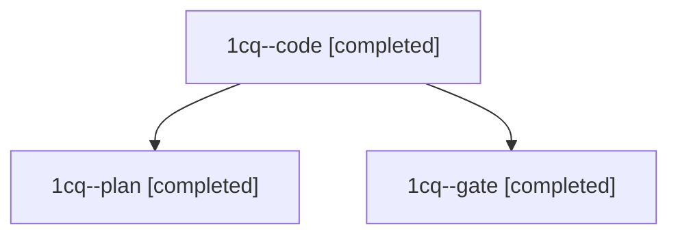

# Session: 1cq

[Agent Hoods](../README.md) / [bbugyi200](../users/bbugyi200/README.md) / [athena](../users/bbugyi200/machines/athena/README.md) / [1cq](../users/bbugyi200/machines/athena/hoods/1cq/README.md) / 1cq

Owner: `bbugyi200.athena` · Hood: `1cq` · Members: 3

## Lineage

The diagram is an optional enhancement; the ordered table below contains the same lineage in accessible text.

| Role | Agent | State | Model / provider | Timing | Commits | Prompt | Chat |
|---|---|---|---|---|---:|---|---|
| code | 1cq--code | completed | muse-spark-1.3-contributor / muse | 2026-11-15T18:23:50.711317+00:00 → 2026-11-15T19:09:50.889779+00:00 | [1](../agents/bbugyi200.athena.1cq--code/README.md#commits) | [Prompt](../agents/bbugyi200.athena.1cq--code/prompt.md) | [Chat](../agents/bbugyi200.athena.1cq--code/chat.md) |
| plan | 1cq--plan | completed | opus / claude | 2026-11-15T18:07:26.737887+00:00 → 2026-11-15T18:18:22.644941+00:00 | 0 | [Prompt](../agents/bbugyi200.athena.1cq--plan/prompt.md) | [Chat](../agents/bbugyi200.athena.1cq--plan/chat.md) |
| gate | 1cq--gate | completed | opus / claude | 2026-11-15T18:19:07.496100+00:00 → 2026-11-15T18:19:44.954030+00:00 | 0 | — | [Chat](../agents/bbugyi200.athena.1cq--gate/chat.md) |

## Commits

| Role | Repo | Commit | Subject | Committed |
|---|---|---|---|---|
| code | bob-cli | [`152a7e2`](https://github.com/bobs-org/bob-cli/commit/152a7e28c1fc1e28d284dc2423ee5aaa60f28362) | feat(capture): allow sentence punctuation in drawer titles | 2026-11-15 14:09:10 EST |
