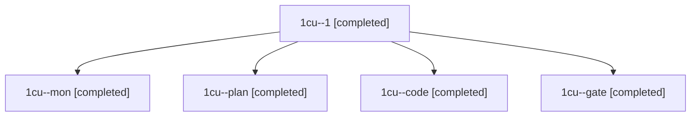

# Session: 1cu

[Agent Hoods](../README.md) / [bbugyi200](../users/bbugyi200/README.md) / [athena](../users/bbugyi200/machines/athena/README.md) / [1cu](../users/bbugyi200/machines/athena/hoods/1cu/README.md) / 1cu

Owner: `bbugyi200.athena` · Hood: `1cu` · Members: 5

## Lineage

The diagram is an optional enhancement; the ordered table below contains the same lineage in accessible text.

| Role | Agent | State | Model / provider | Timing | Commits | Prompt | Chat |
|---|---|---|---|---|---:|---|---|
| 1 | 1cu--1 | completed | gpt-6-luna / codex | 2026-11-16T01:07:05.537652+00:00 → 2026-11-16T01:20:19.701362+00:00 | [1](../agents/bbugyi200.athena.1cu--1/README.md#commits) | [Prompt](../agents/bbugyi200.athena.1cu--1/prompt.md) | [Chat](../agents/bbugyi200.athena.1cu--1/chat.md) |
| mon | 1cu--mon | completed | gpt-6-luna / codex | 2026-11-16T00:52:31.312708+00:00 → 2026-11-16T01:05:45.665425+00:00 | 0 | — | [Chat](../agents/bbugyi200.athena.1cu--mon/chat.md) |
| plan | 1cu--plan | completed | claude-fable-5 / claude | 2026-11-16T00:37:02.828292+00:00 → 2026-11-16T00:46:05.074124+00:00 | 0 | [Prompt](../agents/bbugyi200.athena.1cu--plan/prompt.md) | [Chat](../agents/bbugyi200.athena.1cu--plan/chat.md) |
| code | 1cu--code | completed | gpt-6-luna / codex | 2026-11-16T00:48:01.954632+00:00 → 2026-11-16T00:53:24.889178+00:00 | 0 | [Prompt](../agents/bbugyi200.athena.1cu--code/prompt.md) | [Chat](../agents/bbugyi200.athena.1cu--code/chat.md) |
| gate | 1cu--gate | completed | claude-fable-5 / claude | 2026-11-16T00:46:30.503730+00:00 → 2026-11-16T00:47:29.817787+00:00 | 0 | — | [Chat](../agents/bbugyi200.athena.1cu--gate/chat.md) |

## Commits

| Role | Repo | Commit | Subject | Committed |
|---|---|---|---|---|
| 1 | bob-cli | [`7118906`](https://github.com/bobs-org/bob-cli/commit/711890697901159481582a2772ffb2e0ce30221e) | fix(bank): pass config to ledger recomputation | 2026-11-15 20:19:25 EST |
