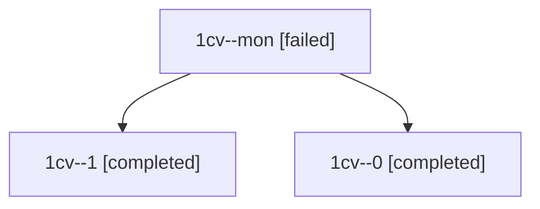

# Session: 1cv

[Agent Hoods](../README.md) / [bbugyi200](../users/bbugyi200/README.md) / [athena](../users/bbugyi200/machines/athena/README.md) / [1cv](../users/bbugyi200/machines/athena/hoods/1cv/README.md) / 1cv

Owner: `bbugyi200.athena` · Hood: `1cv` · Members: 3

## Lineage



The diagram is an optional enhancement; the ordered table below contains the same lineage in accessible text.

| Role | Agent | State | Model / provider | Timing | Commits | Prompt | Chat |
|---|---|---|---|---|---:|---|---|
| <a id="member-mon"></a>mon | 1cv--mon | failed | gpt-6-astra / codex | 2026-11-16T00:58:45.611512+00:00 → 2026-11-16T01:08:27.576340+00:00 | 0 | — | [Chat](../agents/bbugyi200.athena.1cv--mon/chat.md) |
| <a id="member-1"></a>1 | 1cv--1 | completed | gpt-6-astra / codex | 2026-11-16T01:09:07.485368+00:00 → 2026-11-16T01:47:46.875855+00:00 | 0 | [Prompt](../agents/bbugyi200.athena.1cv--1/prompt.md) | [Chat](../agents/bbugyi200.athena.1cv--1/chat.md) |
| <a id="member-0"></a>0 | 1cv--0 | completed | gpt-6-astra / codex | 2026-11-16T00:44:42.437067+00:00 → 2026-11-16T01:00:08.044518+00:00 | 0 | [Prompt](../agents/bbugyi200.athena.1cv--0/prompt.md) | [Chat](../agents/bbugyi200.athena.1cv--0/chat.md) |

## Variables

| Role | Variable | Value |
|---|---|---|
| 1 | `artifacts` | \[{kind: file, label: kr closeout full plugin suite failures on 1caabb8, path: /home/bryan/.sase/artifacts/agents/gh\_bobs-org\_\_bob-cli/20261115200726/plugins-test-021e955d0fdb.log, ref: file:explicit:… |

#### artifacts

**Role:** `1`

```yaml
- kind: file
  label: kr closeout full plugin suite failures on 1caabb8
  path: /home/bryan/.sase/artifacts/agents/gh_bobs-org__bob-cli/20261115200726/plugins-test-021e955d0fdb.log
  ref: file:explicit:ee5e5d9745608935c548c92b
  source_path: /tmp/bob-cli-kr-1cv-verification/plugins-test.log
- kind: file
  label: kr unchanged-tree performance controls: 79 passed
  path: /home/bryan/.sase/artifacts/agents/gh_bobs-org__bob-cli/20261115200726/kr-perf-rerun-b11b3985e148.log
  ref: file:explicit:918a90b28fcc622a5bcac02a
  source_path: /tmp/kr-perf-rerun.log
- kind: file
  label: kr clean-primary compile failure in subscriptions
  path: /home/bryan/.sase/artifacts/agents/gh_bobs-org__bob-cli/20261115200726/primary-check-664079fead61.log
  ref: file:explicit:afa1a0e6e83c8ef403056363
  source_path: /tmp/bob-cli-kr-1cv-verification/primary-check.log
- kind: file
  label: kr clean-base ledger docs word budget failure
  path: /home/bryan/.sase/artifacts/agents/gh_bobs-org__bob-cli/20261115200726/plugins-docs-17a440301920.log
  ref: file:explicit:97b1d98e440b37caf15a9dc2
  source_path: /tmp/bob-cli-kr-1cv-verification/plugins-docs.log
- kind: file
  label: kr clean 1caabb8 timing controls: 79 passed
  path: /home/bryan/.sase/artifacts/agents/gh_bobs-org__bob-cli/20261115200726/kr-clean-base-perf-6de6b6915d92.log
  ref: file:explicit:5780208cbfe9e427b213d6c9
  source_path: /tmp/kr-clean-base-perf.log
- kind: file
  label: kr clean 1caabb8 docs overage control
  path: /home/bryan/.sase/artifacts/agents/gh_bobs-org__bob-cli/20261115200726/kr-clean-base-docs-17a440301920.log
  ref: file:explicit:a72b2f0a2eb5e358d609bd56
  source_path: /tmp/kr-clean-base-docs.log
- bead: bob-cli-kr
  kind: file
  label: kr visual acceptance caught real 375px Schema Card overflow
  path: /home/bryan/.sase/artifacts/agents/gh_bobs-org__bob-cli/20261115200726/album-report-628ca43ff8eb.json
  ref: file:explicit:faa6e177223bda39ec6f2ba9
  source_path: /tmp/bob-cli-kr-recovery3/album-report.json
- bead: bob-cli-kr
  kind: image
  label: kr before fix: unstyled Schema Card targets overflow at 375px
  path: /home/bryan/.sase/artifacts/agents/gh_bobs-org__bob-cli/20261115200726/album-schema-consequence-375-light-da7facc94492.png
  ref: file:explicit:361cedef117c1675a7c1c260
  source_path: /tmp/bob-cli-kr-recovery3/screenshots/album-schema-consequence-375-light.png
- bead: bob-cli-kr.4.1
  kind: file
  label: kr-final-full-plugin-suite
  path: /home/bryan/.sase/artifacts/agents/gh_bobs-org__bob-cli/20261115200726/plugins-test-1d44140feded.log
  ref: file:explicit:b86d31a83214256d04449303
  source_path: /tmp/bob-cli-kr-recovery5/plugins-test.log
- bead: bob-cli-kr.4.1
  kind: file
  label: kr-final-real-obsidian-90-checks
  path: /home/bryan/.sase/artifacts/agents/gh_bobs-org__bob-cli/20261115200726/album-report-35775d10676c.json
  ref: file:explicit:95dc021a9db91b4ff58e0711
  source_path: /tmp/bob-cli-kr-final/album-report.json
- bead: bob-cli-kr
  kind: file
  label: kr-complete-evidence-and-13-reviewed-screenshots
  path: /home/bryan/.sase/artifacts/agents/gh_bobs-org__bob-cli/20261115200726/bob-cli-kr-closeout-evidence.tar-78b4e3952591.gz
  ref: file:explicit:c15ba4d0447c2a518ed86e25
  source_path: /tmp/bob-cli-kr-closeout-evidence.tar.gz
- bead: bob-cli-kr.4.1
  kind: file
  label: kr-final-source-and-screenshot-provenance
  path: /home/bryan/.sase/artifacts/agents/gh_bobs-org__bob-cli/20261115200726/provenance-365792a0e2ca.json
  ref: file:explicit:13993295d87053bcf23111f8
  source_path: /tmp/bob-cli-kr-final/provenance.json
- bead: bob-cli-kr
  kind: image
  label: kr-final-named-child-warnings
  path: /home/bryan/.sase/artifacts/agents/gh_bobs-org__bob-cli/20261115200726/album-named-child-warnings-8f856eef945c.png
  ref: file:explicit:94da8129c6552270cd4f0fc7
  source_path: /tmp/bob-cli-kr-final/screenshots/album-named-child-warnings.png
- bead: bob-cli-kr
  kind: file
  label: kr-final-closeout-audit
  path: /home/bryan/.sase/artifacts/agents/gh_bobs-org__bob-cli/20261115200726/closeout-report-c3a18aabcfac.json
  ref: file:explicit:c1efc6a4fd08e0642211f364
  source_path: /tmp/bob-cli-kr-final/closeout-report.json
```

Values are truncated for display; see each member's agent meta.json for the full values.
