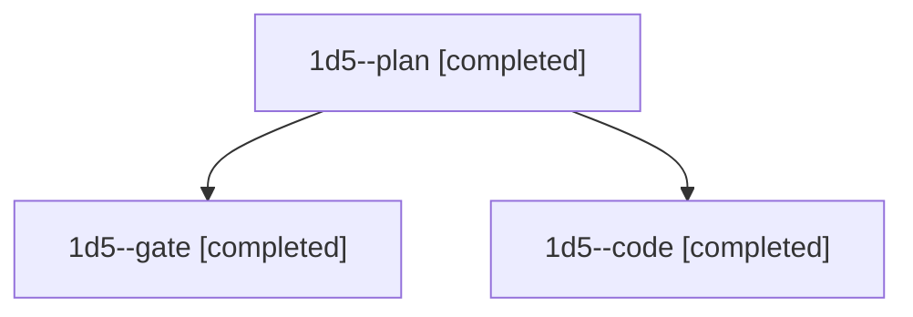

# Session: 1d5

[Agent Hoods](../README.md) / [bbugyi200](../users/bbugyi200/README.md) / [athena](../users/bbugyi200/machines/athena/README.md) / [1d5](../users/bbugyi200/machines/athena/hoods/1d5/README.md) / 1d5

Owner: `bbugyi200.athena` · Hood: `1d5` · Members: 3

## Lineage

The diagram is an optional enhancement; the ordered table below contains the same lineage in accessible text.

| Role | Agent | State | Model / provider | Timing | Commits | Prompt | Chat |
|---|---|---|---|---|---:|---|---|
| plan | 1d5--plan | completed | opus / claude | 2026-11-16T21:01:55.464734+00:00 → 2026-11-16T21:07:19.178583+00:00 | 0 | [Prompt](../agents/bbugyi200.athena.1d5--plan/prompt.md) | [Chat](../agents/bbugyi200.athena.1d5--plan/chat.md) |
| gate | 1d5--gate | completed | opus / claude | 2026-11-16T21:09:07.502657+00:00 → 2026-11-16T21:10:23.129284+00:00 | 0 | — | [Chat](../agents/bbugyi200.athena.1d5--gate/chat.md) |
| code | 1d5--code | completed | grok-4.6 / grok | 2026-11-16T21:10:45.268325+00:00 → 2026-11-16T21:26:44.952587+00:00 | 0 | [Prompt](../agents/bbugyi200.athena.1d5--code/prompt.md) | [Chat](../agents/bbugyi200.athena.1d5--code/chat.md) |
