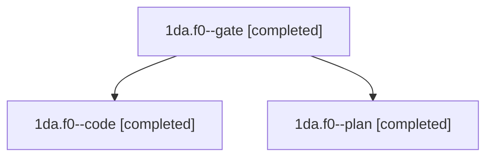

# Session: 1da.f0

[Agent Hoods](../README.md) / [bbugyi200](../users/bbugyi200/README.md) / [athena](../users/bbugyi200/machines/athena/README.md) / [1da](../users/bbugyi200/machines/athena/hoods/1da/README.md) / 1da.f0

Owner: `bbugyi200.athena` · Hood: `1da` · Members: 3

## Lineage

The diagram is an optional enhancement; the ordered table below contains the same lineage in accessible text.

| Role | Agent | State | Model / provider | Timing | Commits | Prompt | Chat |
|---|---|---|---|---|---:|---|---|
| gate | 1da.f0--gate | completed | opus / claude | 2026-11-17T13:16:50.436843+00:00 → 2026-11-17T13:17:24.728577+00:00 | 0 | — | [Chat](../agents/bbugyi200.athena.1da.f0--gate/chat.md) |
| code | 1da.f0--code | completed | muse-spark-1.3-contributor / muse | 2026-11-17T13:17:45.826804+00:00 → 2026-11-17T14:33:46.164589+00:00 | 0 | [Prompt](../agents/bbugyi200.athena.1da.f0--code/prompt.md) | [Chat](../agents/bbugyi200.athena.1da.f0--code/chat.md) |
| plan | 1da.f0--plan | completed | opus / claude | 2026-11-17T13:02:29.224923+00:00 → 2026-11-17T13:13:09.158775+00:00 | 0 | [Prompt](../agents/bbugyi200.athena.1da.f0--plan/prompt.md) | [Chat](../agents/bbugyi200.athena.1da.f0--plan/chat.md) |

## Neighbors

| Agent | Relation | State |
|---|---|---|
| [1da](bbugyi200.athena.1da.md) (session · 3) | ancestor | completed 3 |
